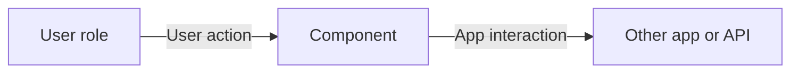

# [Component name]

## Overview

[Describe what the component does, who uses it. 
Call out whether this document is the finalised as-built, or if some parts still contain future state architecture.
Link to the implementation plan(s) if available.

## Business context

[Explain why the component exists and what its users need from it. Show user-to-app and app-to-app interactions at a glance. Replace the example nodes and arrows below, then describe each arrow in the table.]

| From | To | Interaction |
| --- | --- | --- |
| User role | Component | [Describe what the user does and what they get back.] |
| Component | Other app or API | [Describe what is sent, read, or changed.] |

## Functional Requirements

- [Describe an observable capability or rule. Mark it as planned if it is not implemented.]

## Application Architecture

[Describe the parts that make this component work, which APIs it uses, and who owns the data. Note differences between the current and planned architecture where they matter.]

## Technical Guidance

- [Explain how to run and test the component locally.]
- [Record implementation constraints. Link to shared guidance rather than repeating it.]

## Design decisions

- **[Decision]:** [State what was decided, why, and any important trade-offs. Link to the shared decision if it applies beyond this component.]
