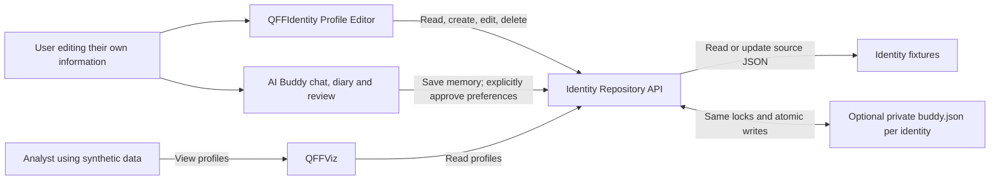

# Identity Repository

## Overview

The Identity Repository is the API for identity-owned source records. The local adapter supports existing fixtures, the [QFFIdentity Profile Editor](../QFFIdentity/readme.md#implemented-profile-editor), and [AI Buddy chat/diary with private file memory and explicit recommendation approval](../QFFIdentity/ai-buddy-design.md), using the same identity folders and persistence implementation. Production sign-in, authorization and full QFF inference provenance remain planned in the [canonical ontology implementation plan](../plan-canonical-ontology.md).

## Business context

Customers control their own preferences. Analysts need authorized cross-profile reads for analysis and data cleansing, but their edits and overrides do not count as customer approval. The diagram shows the current local flow.

| From | To | Interaction |
| --- | --- | --- |
| User | QFFIdentity | Directly manage personal information and preferences without a questionnaire. |
| QFFIdentity | Identity Repository API | Load saved profiles; submit validated, revision-checked identity and preference changes. |
| Analyst using synthetic data | QFFViz | View fixture profiles for development and analysis. |
| QFFViz | Identity Repository API | List and read profiles through the local development adapter. Legacy saves are disabled in QFFViz. |
| Identity Repository API | Identity fixtures | Read the three source files and optional test context; create and delete profiles, edit identity fields, and create/edit/delete preferences under revision checks. |

## Functional Requirements

| Local API | Behavior |
| --- | --- |
| `GET /api/v1/profiles` | List available fixture selectors as `profile_ids`. Each is also a simulated external ID. |
| `GET /api/v1/profiles/{externalId}` | Resolve the ID and return identity, relations, preferences, properties `revision`, `identity_revision` and whole-document `profile_revision`. Include `profile.personas` only when optional test context is present, for compatibility with the scripted baseline. |
| `POST /api/v1/profiles` | Create a fixture from a top-level `external_id` and `identity`, `relations`, and `properties` objects. The API sets each document's internal `identity_id`; callers need not supply it. An optional `personas` document is written as test context. Missing preference GUIDs are assigned; duplicate profile IDs are rejected. |
| `PUT /api/v1/profiles/{externalId}/preferences/{preferenceId}` | Resolve the fixture ID and update an existing preference's keyword, definition, kind, and persona affinities. Supply the revision in `If-Match`; reload on `412` before retrying. |
| `POST /api/v1/profiles/{externalId}/preferences` | Add a preference with the same editable fields and properties `If-Match`; generate a stable GUID and return `201 { preference_id, revision }`. |
| `DELETE /api/v1/profiles/{externalId}/preferences/{preferenceId}` | Delete a single preference under properties `If-Match`; return `{ revision }`. |
| `PATCH /api/v1/profiles/{externalId}/identity` | Edit optional name, summary, gender, location, occupation, age and custom `details` using `identity_revision` in `If-Match`. Return `{ identity_revision }`. Omitted fields are preserved; null or empty text clears a field. |
| `DELETE /api/v1/profiles/{externalId}` | Require `profile_revision` in `If-Match`, lock source files, check the whole profile, and remove it. Return `204`. |
| `GET /api/v1/ai-assistance` | Return sanitized configuration availability; never call the model or expose keys. |
| `GET /api/v1/profiles/{externalId}/buddy/memory` | Return saved conversations, diary entries, recommendations and a memory revision; no provider call. |
| `POST /api/v1/profiles/{externalId}/buddy/messages` | Save the user entry, read the selected profile and bounded memory, call the provider, and store the reply/recommendations. Failed calls preserve the entry. Request UUIDs prevent duplicate entries on retry. Confirmed preferences are unchanged. |
| `POST /api/v1/profiles/{externalId}/buddy/proposals/{proposalId}/review` | Refresh a pending recommendation's source, comparison and properties revision for later explicit approval. No model call. |
| `POST /api/v1/profiles/{externalId}/buddy/proposals/{proposalId}/dismiss` | Persist dismissal without changing preferences. |
| `POST /api/v1/profiles/{externalId}/buddy/approvals` | Require explicit confirmation of a server-bound proposal. Atomically add approved wording, preserve superseded source records, and store an idempotency receipt. |
| `DELETE /api/v1/profiles/{externalId}/buddy/conversations/{conversationId}` | Require memory `If-Match`; delete the conversation and its recommendations, preserving approved preferences. |

Preference writes accept `keyword` (1–120 characters), `definition` (1–4000), one of `interest`, `want`, `value`, `boundary`, up to 50 unique context affinities, and optional `want_type` for wants. Each affinity retains a signed number between -1 and 1 and a context name of at most 120 characters; the empty name is identity-wide. Identity text fields allow 200 characters (summary: 4000); age is an optional integer from 0 to 150. Optional `details` holds up to 50 `{ label, value }` pairs (120/4000 characters). IDs, provenance, relations and approved personas are preserved during these ordinary edits. All requests retain the existing 64 KiB body limit.

Missing `If-Match` revisions return `428`, stale revisions `412`, and concurrent writes `409`. The editor preserves unsaved input on failure and requires an explicit reload/review before another save. Properties and identity revisions are independent; whole-profile deletion also checks relations, optional test context and optional Buddy memory. The ordinary profile response does not expose Buddy messages.

Preference validation errors return `{ error, fields }`, where `fields` maps editor keys such as `keyword`, `definition`, or `personas.0.persona` to English messages using Title, Description, Category and Context. Validation is shared with the frontend. Manual additions and edits reject new normalized duplicates under the existing write lock (`409` with field feedback), and trim outer whitespace before saving. Existing duplicate source records are not merged or reassigned automatically; edits that retain their existing collision are allowed. Empty `personas: []` means no affinity is set, while an explicit empty Context name is Identity-wide.

Preferences optionally carry `want_type: wish | goal` when `kind` is `want`; old records need no migration. Buddy approvals add `buddy_approval: { proposal_id, approved_at }` and, for refinements, `supersedes`/`superseded_by` links. Those lifecycle fields are server-owned. Read responses retain historical records; consumers should exclude `superseded_by` records from active lists and matching. Full persisted QFF inference references and multi-source consolidation remain planned.

## Application Architecture

A TypeScript/Node.js Azure Functions app serves [tracked JSON fixtures](../Identities/). The resolved internal `identity_id` selects `Identities/<id>/` and the `<id>-*.json` files in it. The external ID is not a field in those documents. `*-test-context.json` is optional and is not part of the preference revision. Derived vectors and mappings belong to the [QFF Repository](../QFFRepository/readme.md), not the identity files.

Buddy adds an optional `<id>-buddy.json` to that folder, created on the first entry. Version 1 stores conversations (including diary dates/focus), user turns, responses and pending/approved/dismissed recommendations. It uses the existing file lock and atomic rename, owner-only `0600` permissions and a 5 MiB limit. It is plaintext personal data, excluded from Git under the default identity root. Include it in private backups to preserve memory; custom roots need their own ignore rules. Existing source documents require no migration. See [file memory and retention](../QFFIdentity/ai-buddy-design.md#file-memory-and-retention) for the schema and limits.

Production will resolve a verified, provider-scoped login ID (Entra ID or social login) to a separate internal `identity_id` and enforce access through the API. Fixture mode uses the same value for both IDs without authenticating anyone.

## Technical Guidance

- With Azure Functions Core Tools installed, set `FUNCTIONS_WORKER_RUNTIME=node` and `QFF_FIXTURE_MODE=1` in your shell. From this folder, run `pnpm start` (port 7181, loopback only) or `pnpm test` for the repository tests.
- `QFF_IDENTITY_ROOT` optionally selects a different source directory; the default remains `module/QFF/Identities`. The browser regression check sets this to a disposable empty directory and cleans it up. It uses the same JSON repository, not a parallel store.
- The fixture resolver has no authentication. It accepts the selected profile ID only for local development and refuses hosted Azure requests (`WEBSITE_SITE_NAME`) or requests without fixture mode. Production deployment needs the planned verified identity/ownership resolver.
- Run `pnpm run migrate:fixtures` to assign missing preference GUIDs and remove legacy vector fields. It is safe to rerun on the synthetic fixtures.

### AI Buddy workstation settings

AI Buddy runs in this local Functions process. Configure each developer machine in `local.settings.json` using [local.settings.json.example](local.settings.json.example); copy it only when no local file exists, otherwise merge its keys. The real file is Git-ignored. Its `Values` use strings: `QFF_AI_MODE=live` enables the configured provider; missing mode, `disabled` and the former design-only `sample` value make no model calls. `LLM_BASE_URL`, `LLM_MODEL`, `LLM_API_KEY` and `LLM_TIMEOUT_MS` configure the OpenAI-compatible endpoint on the backend. The tracked example defaults to disabled.

For DeepSeek, set the base URL to `https://api.deepseek.com` and model to `deepseek-flash`. Direct DeepSeek requests disable thinking, cap output at 1,536 tokens and request JSON. Buddy sends a bounded conversation window and asks for concise replies; it never retries paid requests automatically. These controls reduce per-message usage, but do not impose a monthly spending cap. See [Buddy setup and cost controls](../QFFIdentity/ai-buddy-design.md#workstation-setup).

For Gemini, set the base URL to `https://generativelanguage.googleapis.com/v1beta/openai/` and, for example, model `gemini-2.5-flash`. Put the Gemini API key in `LLM_API_KEY`. Direct Gemini requests cap output at 1,536 tokens, request JSON and minimize thinking (`none` for Gemini 2.5, otherwise `low`).

See the [implemented Buddy design](../QFFIdentity/ai-buddy-design.md) for configuration validation, request/response shapes, bounds, memory and approval behavior. Restart the local Functions host after settings changes. Chat/diary entries and recommendations persist in the private Buddy file across worker restarts, including while waiting for later review. Only explicit approval writes confirmed preferences through the existing repository lock and atomic replacement. The properties approval receipt is authoritative if the separate memory-status update is interrupted. Missing AI configuration still permits diary saving; it never generates a sample response.

## Design decisions

- **Stable source IDs:** Preserve valid internal `identity_id` values and assign each preference an opaque, immutable GUID. Do not derive preference IDs from wording or array position; derived records link by ID without copying the authoritative source.
- **Identity-wide scope:** An affinity entry with `"persona": ""` applies to the identity without requiring a named persona or test context.
- **Identity resolution:** Only fixture mode treats the caller-supplied external ID as the internal ID. The production resolver must use verified login claims, not an ID supplied in the request body or path as proof of identity.
- **Revision-checked writes:** Check the revision under a per-file lock and replace the file atomically so concurrent saves cannot silently overwrite one another. Reject stale revisions.
- **Derived-data invalidation:** Source edits and deletions make QFF-derived data stale. Reconcile it during a full refresh rather than tracking stale state on every derived record or requiring immediate propagation.
