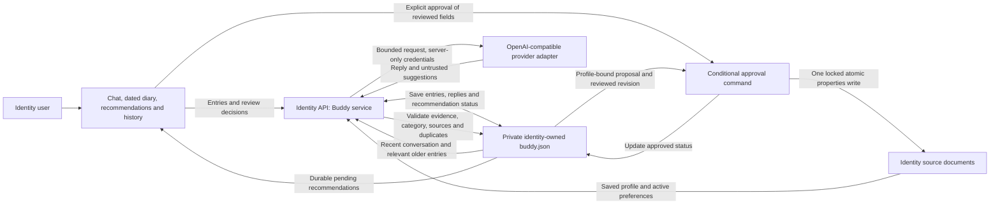

# QFF Identity AI Buddy

## Implemented scope

AI Buddy is a self-service conversation and diary inside QFFIdentity. It reads the selected user's saved personal information, active preferences and relevant conversation memory, asks follow-up questions, and collects recommendations. Recommendations stay separate from confirmed preferences until the user reviews their evidence, category, description, context and similar records, optionally edits the wording/category, and chooses **Approve & save**. They can be reviewed later or dismissed.

The Recommendations view shows pending items in equally sized cards, with consistent description fields and actions aligned at the bottom. Approved and dismissed items leave this review queue; their decisions remain in saved memory, and approved preferences are available in Preferences.

The interface has **Chat**, **Diary**, **Recommendations** and **History** views. Diary entries have a date and a focus: **What happened today** or **Hopes for the future**. Both can lead to tentative preferences; an event alone does not establish a lasting like or dislike. User entries are saved before calling the model, so diary writing remains usable when AI is unavailable.

The chat UI shows the outgoing message immediately, then a replying indicator. The composer stays editable for the next draft while submission is disabled. Once the complete validated reply arrives, the client reveals its text over at most 1.8 seconds; this is a display effect, not provider token streaming, and makes no extra model calls. **Show full reply** and reduced-motion preferences skip the effect. Saved history is never replayed. The transcript follows incoming text only while the user stays near the bottom; reading earlier messages preserves the scroll position. A failed/uncertain delivery stays visible and retries reuse the same request UUID. Reloading memory reconciles an already-saved request after a lost response.

The composer remains anchored at the bottom, including in empty conversations. Its input height and Send/Save entry button dimensions and labels stay fixed across request states; longer drafts scroll within the input. Routine save notifications are omitted from chat. Loading, connection and error feedback lives within the scrolling transcript, so it cannot reduce the transcript viewport or move the composer.

This implementation keeps the vanilla TypeScript/Vite UI, local Functions API and existing Identity Repository. It adds one optional private Buddy document alongside the three source documents, using the same file locks and atomic replacement. It adds no database, framework or runtime dependency. Questionnaire remains a separate communication feature. QFFMatcher is a starter and is not invoked by Buddy.



## Classification and source compatibility

| Chat category | Meaning | Existing source representation |
| --- | --- | --- |
| Like | Something enjoyed | `kind: interest`, positive affinity |
| Dislike | Something disliked | `kind: interest`, negative affinity |
| Want | Something to have or experience | `kind: want`, optional `want_type: wish` |
| Goal or ambition | An outcome to achieve | `kind: want`, optional `want_type: goal` |
| Value | A principle guiding decisions | `kind: value` |
| Boundary | A chosen limit | Existing `kind: boundary` |

The prompt prioritizes likes, dislikes, wants and goals. It explicitly distinguishes “I want to become wealthy” from a value, and a narrow server guard corrects explicit outcome language that the model incorrectly labels as a value. This is not a general deterministic language classifier: semantic accuracy depends on the configured model and user review. Tests verify the prompt, mapping, and guard with controlled responses; they do not establish live-model accuracy.

`want_type` is additive and optional. Existing wants without it remain valid and are displayed as “Want or goal”; no migration or inference of old classifications runs. Ordinary edits preserve it while the kind remains `want`, and clear it when the kind changes.

The default context is **Identity-wise**, persisted as the existing `persona: ""`. Existing editor labels use “Identity-wide” for the same scope. Named contexts are optional proposals supported by the user's words, visible before approval; they do not create `identity.personas` descriptions. Refinements preserve the original context affinities. Buddy does not require people to fill in values or assign personas.

## Approval and preservation

- A server-generated proposal UUID is bound to one profile and the properties revision read before generation. The model cannot choose the binding or approval ID.
- Pending recommendations persist in the private Buddy document across refreshes, browser closure and worker restarts. They do not expire after 30 minutes and are not included in active preferences or matching inputs.
- `confirmed: true` and a valid pending proposal are required. The approval accepts the final reviewed preference fields, not provider-issued write commands.
- A new addition gets a new preference GUID. A refinement also gets a new GUID; the old record retains its ID, wording, affinities and unknown fields, and gains `superseded_by`. The new record has `supersedes` pointing to the original.
- Each new record stores a minimal `buddy_approval: { proposal_id, approved_at }` receipt. The receipt and supersession change are committed together by the existing file lock and atomic replace. The receipt makes a repeated/lost-response approval idempotent, including after a worker restart. Buddy then records the approved wording and status. These are two separate file writes, not a cross-file transaction: if the worker stops between them, the properties receipt is authoritative and the memory API reconciles the approval on read.
- Active UI lists and Buddy memory exclude superseded records; the read API still returns the preserved history. Ordinary CRUD and existing identity/relations remain intact. A history/restore UI is future work.
- A changed properties revision rejects approval with `412`; missing, dismissed or wrong-profile pending proposals return `404`. **Review latest** refreshes the source and similar-preference comparison without another model call, retains the user's draft wording/category, and requires explicit approval again. Approving one recommendation changes the revision, so older pending recommendations require this review. If a refinement's source has been removed or superseded, the user must dismiss it and request another suggestion.
- Exact normalized keyword/description duplicates with compatible kind and context/sign are suppressed at generation and rejected under the write lock. Similar keyword overlaps are shown for comparison and require an explicit “separate preference” acknowledgment. The model is also prompted to find semantic duplicates; arbitrary paraphrase detection is not guaranteed without future semantic retrieval. Opposite signs and context differences are not silently merged.

These are local self-service approval receipts and private working recommendations, not QFF-owned canonical inference records. The broader ontology's `inference_ref`, QFF Repository provenance endpoint, multi-source consolidation and QFFLineage generation/approval datasets remain separate future integration work. No fictitious lineage events or canonical inference records are created.

## File memory and retention

The optional file is `Identities/<identity_id>/<identity_id>-buddy.json`, or the same relative location under `QFF_IDENTITY_ROOT`. Reading an unused Buddy does not create it; the first submitted entry creates it. Existing identity/properties/relations records need no migration.

| Stored field | Purpose |
| --- | --- |
| `version: 1`, `identity_id` | Format version and profile binding. |
| `conversations[]` | UUID, title, `mode: chat \| diary`, optional diary date/focus, created/updated times and turns. |
| `turns[]` | Client request UUID, original user text, timestamp, processing/complete/failed status, optional reply/error and temporary generation lease. |
| `proposals[]` | Server proposal UUID, conversation/request link, timestamp, category, wording, evidence, reason, source/comparison, properties revision, pending/approved/dismissed status and approved preference ID. |

Files are written with owner-only `0600` permissions on supported systems. They contain **plaintext**, not encrypted data. `Identities/.gitignore` excludes Buddy files, locks and temporary files; a custom identity root outside that tree needs its own ignore rules. Backups or transfers that should preserve chat memory must include this optional file and treat it as personal data. The app keeps no transcript copy in localStorage; browser state holds only current UI state and unsaved drafts.

History opens or deletes a saved conversation/diary and its associated recommendations. Deletion checks the memory revision and preserves already approved preferences in the properties document. Full-profile deletion includes Buddy memory, checks a whole-profile revision and locks the Buddy file alongside source files. The ordinary profile API includes Buddy content in that revision hash but never exposes the transcript in its profile payload. Corrupt/unsupported memory is reported and left unchanged, not reset silently.

Limits are 5 MiB per Buddy file, 500 conversations per profile, 100 turns per conversation, and 1,500 stored recommendations. The API rejects growth beyond these bounds with guidance to delete older conversations or start a new conversation, as appropriate. There is no automatic expiry or silent history deletion. A single document keeps this local implementation simple; larger archives and indexed retrieval are future work.

## Model context and retries

Each turn reloads saved identity information and active preferences. The chosen profile's name, age, gender, introduction, occupation, location, custom details, personas and preferences are included. Contact relations, other profiles, legacy test narratives, and repository files are excluded.

The provider receives the latest conversation window (up to 16 messages, with a 12,000 serialized-character budget), up to four older user entries from other conversations ranked by word overlap and recency (4,000 content characters), and the latest 30 recommendation decisions. The current entry is always retained whole, even if JSON escaping makes that entry alone exceed the history window; the complete prompt limit still applies. Older memory carries its date and mode. Stored history remains intact when outside the prompt window; this is bounded retrieval, not a guarantee that every past answer will be recalled. No embeddings or additional memory service are required.

The complete system prompt and serialized input are capped at 48,000 characters. Oversized profile context is rejected before a provider call, with the user's entry already saved. Chat input allows 2,000 characters and diary input 6,000. These are character bounds, not a provider-specific token guarantee.

The fixed prompt directs Buddy to use known answers, avoid repeated questions and dismissed proposals, distinguish events from enduring preferences, and treat unapproved suggestions as tentative. Evidence must quote user text supplied in the bounded context. Future hopes map to wants or goals; sensitive traits and diagnoses must not be inferred from diary events.

Every submission includes a client-generated request UUID. Repeating a completed request returns the saved result without another model call. Failed entries can be retried explicitly using that same ID without duplicating the entry. An in-process guard and a persisted 150-second generation lease prevent simultaneous generations for the same profile; an interrupted attempt can be retried after its lease expires. Generation IDs reject superseded late responses, and deleting a conversation while the provider is responding cannot recreate it. Retries are user initiated, never automatic.

## API and provider boundary

| Operation | Contract |
| --- | --- |
| `GET /api/v1/ai-assistance` | `{ available, reason? }`; checks configuration without calling the model or returning credentials. |
| `GET /api/v1/profiles/{id}/buddy/memory` | `{ revision, memory }`, including saved conversations and recommendations. Does not call the provider. |
| `POST /api/v1/profiles/{id}/buddy/messages` | `{ request_id, conversation_id?, message, mode?: "chat" \| "diary", diary_date?, diary_focus?: "today" \| "future" }`. Diary requires a valid ISO date and focus. Saves the entry first; returns `{ conversation_id, request_id, reply?, error?, proposals }`. Provider failure returns a saved failed turn with `error`; it does not change preferences. Validation/storage errors use non-2xx responses. |
| `POST /api/v1/profiles/{id}/buddy/proposals/{proposalId}/review` | Refresh the pending recommendation's properties revision, source and similar records; returns the updated recommendation without calling AI. |
| `POST /api/v1/profiles/{id}/buddy/proposals/{proposalId}/dismiss` | Persist dismissal; confirmed preferences are unchanged. |
| `POST /api/v1/profiles/{id}/buddy/approvals` | `{ proposal_id, revision, confirmed: true, category, preference, acknowledge_similar?: boolean }`. Returns `{ preference_id, revision }`. The server checks its proposal binding and reviewed revision under the write lock. |
| `DELETE /api/v1/profiles/{id}/buddy/conversations/{conversationId}` | Requires memory `revision` in `If-Match`. Removes that conversation and its recommendations, preserving approved preferences. |

All routes retain the local fixture-mode guard and 64 KiB HTTP body limit. Production verified ownership/authentication remains a prerequisite for hosted deployment, as with the existing editor.

The provider implements the small `BuddyProvider.complete(system, input)` interface. It follows the project's existing OpenAI-compatible `POST /chat/completions` convention and workstation settings, without importing dashboard orchestration or its mandatory strict JSON-schema response mode. The wire contract is documented by [OpenAI's Chat Completions reference](https://developers.openai.com/api/reference/resources/chat/subresources/completions/methods/create). A model must return JSON text; no tool calling or provider-specific structured output is required. Output is validated, including quoted evidence actually present in a user message, source ownership and affinity ranges. Raw model content is rendered as text, never HTML.

Responses are capped at 32 KiB. Timeout is configurable from 1–120 seconds. Redirects are rejected, provider errors are sanitized, and keys never reach the browser or logs. Provider failure preserves the message for explicit retry. Missing configuration shows an unavailable state while diary saving and manual editing remain usable. Configuring a remote provider sends the selected profile and bounded personal memory to that provider. No sample mode, fake chat responses or model calls on page load are shipped in the product.

The prompt treats active preferences as established knowledge and asks Buddy to connect relevant interests naturally, add a useful observation or idea, and avoid rediscovering them or presenting an interest checklist. Replies default to 3–5 conversational sentences and at most two concise recommendations. An explicit request for language, format or brevity (including one sentence) takes precedence over that default, while approval/privacy and the JSON response contract stay mandatory. Direct requests to `api.deepseek.com` additionally disable thinking, cap the entire generated JSON reply at 1,536 output tokens, and enable JSON output. This avoids DeepSeek's default thinking mode and its much larger output allowance. Other compatible endpoints keep their existing provider parameters. A response stopped at the token limit is reported without an automatic paid retry; the entry remains saved. There is no cumulative spending cap, and input tokens are still billed.

## Workstation setup

Merge these keys into `IdentityRepository/local.settings.json` under `Values`, without replacing other settings:

```json
{
  "QFF_AI_MODE": "live",
  "LLM_BASE_URL": "https://your-compatible-endpoint.example/v1",
  "LLM_MODEL": "your-configured-model",
  "LLM_API_KEY": "",
  "LLM_TIMEOUT_MS": "30000"
}
```

Supply the actual key locally. HTTPS is required except for loopback HTTP, where an unauthenticated provider may omit the key. URL credentials/query strings/fragments are rejected. Keep settings Git-ignored and restart the Functions host after changes. `disabled`, missing mode, and the former design-only `sample` setting leave Buddy unavailable and make no model calls.

For the lower-cost DeepSeek setup, use `LLM_BASE_URL=https://api.deepseek.com`, `LLM_MODEL=deepseek-flash` and `LLM_TIMEOUT_MS=60000`, with the DeepSeek key in `LLM_API_KEY`. The provider-specific output/thinking defaults above apply automatically. As checked on 23 November 2026, Flash is cheaper than V4 Pro in the [official pricing table](https://api-docs.deepseek.com/quick_start/pricing/); prices and peak/off-peak rates can change. The [DeepSeek Chat Completions contract](https://api-docs.deepseek.com/api/create-chat-completion/) documents `thinking`, `max_tokens` and JSON output.

For Gemini's OpenAI-compatible endpoint, use `LLM_BASE_URL=https://generativelanguage.googleapis.com/v1beta/openai/`, `LLM_MODEL=gemini-2.5-flash` and the Gemini key in `LLM_API_KEY`. Gemini requests use Bearer authentication, JSON output, a 1,536-token cap and `reasoning_effort=none` for Gemini 2.5 (`low` for later Gemini model families). See [Google's OpenAI compatibility guide](https://aistudio.google.com/docs/openai).

## Future matching

The existing preference IDs, `kind`, signed affinity, optional want subtype and context scope carry the needed inputs without a new matching schema. A future matcher should use **active** records, prioritize shared positive interests, compare wants/goals against the other person's dislikes for potential friction, consider strength/context, and give self-reported values relatively little weight. Missing information means unknown, not agreement. Outcomes should be recommendations with uncertainty and permitted explanations, never absolute judgments or disclosures of the other person's private profile. No matching engine, calibrated compatibility probability, embedding pipeline or cross-person query is implemented here.

## Verification and changed files

Run the repository tests and UI build, then the existing browser check (which starts a test-only OpenAI-compatible HTTP server and an empty temporary identity repository). All test data is removed afterward; tests do not write to checked-in profiles or contact live providers.

- `IdentityRepository/src/buddy.ts`: bounded chat/diary orchestration, durable recommendations, retry deduplication, later review and approval validation.
- `IdentityRepository/src/buddy-memory.ts`, `Identities/.gitignore`: optional private file storage, validation, revision and size limits, Git exclusions.
- `IdentityRepository/src/buddy-provider.ts`: workstation configuration and modular provider adapter.
- `IdentityRepository/src/buddy-preferences.ts`: category mapping, the explicit-goal guard and duplicate comparisons.
- `IdentityRepository/src/repository.ts`, `contracts.ts`, `index.ts`: compatible fields, atomic approval persistence and routes.
- `QFFIdentity/src/buddy.ts`, `main.ts`, `api.ts`, `style.css`: chat, dated diary, recommendations and history UI, navigation, active-record filtering and bounded request timeout.
- `IdentityRepository/src/buddy.test.ts`: classification, approval, duplicates, stale review, profile isolation, source preservation, restart persistence, diary dates/focus, unavailable provider, retry deduplication, deletion during generation, receipt recovery and file validation/permissions.
- `QFFIdentity/buddy-browser-check.mjs`, `browser-check.mjs`: real browser → Functions → controlled provider → diary/chat → reload → later approval → repository files, history deletion, failure retry, plus editor regressions and responsive states at 320–1366px.
- Both READMEs, `IdentityRepository/package.json` and `local.settings.json.example`: integration/setup/test instructions.

Future work: live-model business scenario evaluation, stronger semantic memory/duplicate retrieval for large profiles, encrypted/exportable archives, persisted QFF inference provenance and lineage, multi-source review, preference-version restoration, and confirmed contextual-pattern suggestions beyond explicit context mentions. Production authentication remains outside this local feature.
