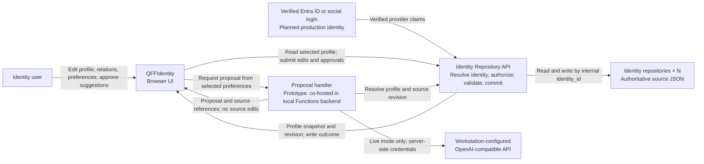
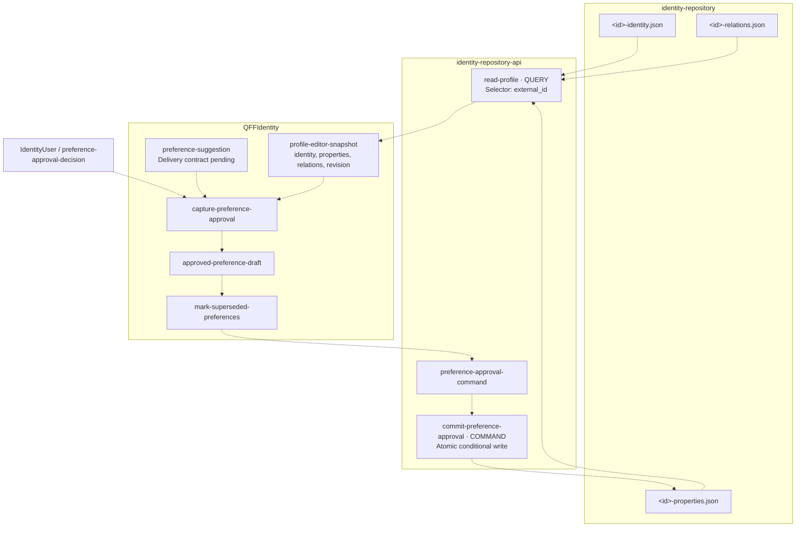

# QFFIdentity

## Overview

QFFIdentity is the customer app for managing identity information and personal preferences. Its initial English-language Profile Editor supports manual creation, viewing, editing and deletion through the existing Identity Repository API. The broader design includes relations and explicit approval of proposed wording and inferred personas, reconciled with the [canonical ontology implementation plan](../plan-canonical-ontology.md) and the [QFFLineage baseline](../QFFLineage/events/baseline/).

The editor extends the Phase 1 local repository APIs with preference creation/deletion, identity editing and whole-profile deletion. AI Buddy adds conversations, a dated diary, persistent private memory and recommendations for later, revision-checked approval. Production authorization and the broader QFF inference-provenance workflow remain unimplemented. Automated persona discovery remains deferred until the persona-optional experiment is evaluated; recording an approved persona does not authorize automatic discovery or publication.

The [AI Buddy implementation and design](ai-buddy-design.md) covers chat, diary, classification, recommendation review, file memory, tests and future matching inputs. Workstations select an OpenAI-compatible endpoint, model and API key through backend `local.settings.json`. Live generation requires a configured connection; diary entries can still be saved without one. No sample chat responses are shown in the product.

## Implemented Profile Editor

This is a self-service editor: users write their own information directly. **Questionnaire is a separate communication feature**, where one person asks another person questions. No questionnaire completion is required to create or change an identity.

- **My profile:** edit optional name, introduction, location, occupation, age and gender; add any number of personal label/value fields within the repository's limits; clear fields to remove them; explicitly confirm deletion of the whole profile.
- **Preferences:** add, search, filter, edit and delete freely written likes/dislikes, wants/goals, values and boundaries. Interest affinities retain their signed values; one preference can apply differently in different contexts.
- **Affinity display:** compact rows show each saved context's signed affinity with ten red negative ticks, a yellow zero marker and ten green positive ticks. Each tick is 2px wide with a 1px gap; magnitude fills outward from zero in tenths. The gauge appears to the left of its context text, without numeric labels. Accessible meter semantics are preserved. Selecting a context narrows the gauges; different contexts are never averaged, and missing affinity is shown as “Not set.”
- **Readable content:** preference titles, descriptions and context names wrap in full without ellipsis or line limits. Rows grow only with their content. When the list pane narrows, category and affinity details move below the full-width text rather than squeezing it between fixed columns.
- **Contexts:** use identity-wide scope or enter your own context names, such as Work, IT, Church or Personal. Names come from saved affinities or approved personas; the app does not seed them or manufacture persona descriptions. These scopes reuse `preferences[].personas` and remain separate from future inferred-persona approval.
- **Validation and duplicates:** Title/Description reject whitespace-only input before submission, with English errors next to the fields. Duplicate Context rows are identified individually. Manual saves and Buddy approvals use the same normalized title/description comparison within compatible categories, contexts and affinity directions. Existing ambiguous source records are preserved and can be edited without introducing additional duplicates.
- **Search and review feedback:** searches ignore surrounding whitespace and case; category counts include both search and Context filters. Empty categories have their own message. `Not set` is separate from explicit Identity-wide affinity. Successful saves open the item’s page and highlight it. In-app discard and chat deletion use keyboard-accessible confirmation dialogs; browser/tab closing retains the browser’s unsaved-change protection.
- **Persistence:** all profile content goes through the Identity Repository API to the existing identity/properties/relations files. `localStorage` remembers only the selected profile ID; the URL also carries that selector. Returning to the app reloads the saved records. No profile or sample preferences are created on startup.
- **Editing:** explicit save, discard confirmation, deletion confirmation, validation and revision conflicts. A failed write keeps the form; **Load latest & keep draft** refreshes the snapshot while preserving the draft for an explicit review and save.
- **Workspace layout:** the top bar displays the current page title and its actions, switching between My preferences, My profile and My contexts as users navigate. The body starts directly with the page content, alongside consistent SVG navigation icons and a persistent status bar. Preferences default to 100 items per page, with a 10/50/100/200 selector. Pagination appears only when results exceed the selected limit; opening an editor or resizing the window keeps the current page. Filtering returns to the first page. Long lists scroll inside their panel while pagination and save actions stay visible. Narrow screens use a single-pane editor. Long text or many contexts/custom fields remain accessible inside their panels without extending the whole page.

The UI intentionally contains no prototype, AI-mode or sample-profile badges. AI proposals are available in the separate **AI Buddy** navigation item. Inferred-persona approval, relations editing and Questionnaire remain outside this implementation. Existing relations and approved persona data are preserved during identity and preference edits.

## Implemented AI Buddy

- **Chat** uses the selected profile, recent conversation and relevant older memory, prioritizing likes, dislikes, wants and goals; values are optional. Goals use the compatible `kind: want, want_type: goal` representation.
- **Conversation experience:** sent messages appear immediately, with a replying indicator and an editable composer for the next draft. New replies reveal progressively after the server response is validated; **Show full reply** skips the effect and reduced-motion preferences disable it. History opens fully displayed. Scrolling up keeps the reading position, with a jump-to-latest action. Enter sends, Shift+Enter inserts a newline, and IME composition does not send. Failed deliveries retain the message for explicit retry.
- **Stable chat layout:** the transcript and composer use the available panel width with consistent side padding. The composer stays at the bottom with a fixed height and button label through typing, sending and completion. Longer drafts scroll inside the input. Saving does not insert a success banner; connection and error messages appear inside the transcript without shrinking it.
- **Diary** accepts dated entries about what happened today or hopes for the future. It saves the original entry before asking Buddy to reflect and infer tentative preferences. An event alone is not treated as a lasting preference.
- **Recommendations** persist for later review and show supporting words and similar saved preferences. The user can edit wording/category, archive, or approve. Archived recommendations leave the active queue and remain available in the separate **Archive** table after reload. Generation saves private memory and recommendations, never confirmed preferences. If the profile has changed, **Review latest** refreshes the comparison before another explicit approval.
- Approval reuses the Identity Repository's lock and atomic write. Refinements preserve original wording under a new preference GUID with supersession links; active lists show the approved version. Repeated approvals cannot create duplicate records.
- Context defaults to Identity-wide (`persona: ""`). Existing context affinities are preserved during refinements. No inferred persona descriptions are silently saved.
- **History** reopens saved conversations and diary entries after refresh or restart. Deleting a conversation removes its messages and active recommendations while preserving archived recommendations and approved preferences.
- Conversations and active/approved recommendations live in `<identity_id>-buddy.json`; archived recommendations live in `<identity_id>-buddy-archive.json` in the same identity folder. Existing archived/dismissed records migrate on the next memory read or write. Both files use repository locks and atomic writes, owner-only permissions and Git exclusions. There is no transcript database or localStorage copy. See the design for limits and backup details.
- Loading, error, explicit retry, unavailable and empty states keep manual editing available. Failed model calls preserve the entry; retries do not duplicate it. Diary saving works without an AI connection.

See [AI Buddy architecture, API contracts, changed files and remaining work](ai-buddy-design.md). The broader ontology/lineage design below still includes future multi-source inference provenance and persona workflows; it does not imply those flows are implemented by the local Buddy approval receipt.

### Run and verify

From the repository root, after installing workspace dependencies:

```sh
pnpm --dir module/QFF/IdentityRepository start
pnpm --dir module/QFF/QFFIdentity dev
```

Open `http://127.0.0.1:5181`. Vite proxies `/api` to the local Functions host at `http://127.0.0.1:7181`. The backend needs `FUNCTIONS_WORKER_RUNTIME=node` and `QFF_FIXTURE_MODE=1` in its environment or Git-ignored `local.settings.json`; see [Identity Repository setup](../IdentityRepository/readme.md#technical-guidance). Existing saved profiles can be opened explicitly; new profiles start empty with only the name entered by the user.

The existing selector is a **local development identity context, not authentication**. The API refuses requests outside its local fixture mode; production requires the verified identity/ownership resolver described below. Both development servers bind to loopback. Optional backend `QFF_IDENTITY_ROOT` selects a separate directory while retaining the same repository implementation and file format.

```sh
pnpm --dir module/QFF/IdentityRepository test
pnpm --dir module/QFF/QFFIdentity build
pnpm --dir module/QFF/QFFIdentity test:browser
```

The browser check uses the workspace Playwright dependency, installed Google Chrome and Azure Functions Core Tools. It starts isolated servers on ports 15181/17181, an empty temporary repository and a controlled OpenAI-compatible test server. It verifies editor CRUD, return visits, contexts, paging, conflict recovery and responsive layouts, plus Buddy chat, dated diary/future hopes, restored history, later approval, goals, duplicate prevention, preserved refinements, history deletion, provider retry and profile isolation. Test records and servers are removed afterward; checked-in identity records are never used for test writes and no live model is contacted.

## Business context

Customers control their identity-owned source records and what their preferences say. An inferred interpretation or an analyst's concept/mapping decision does not count as customer approval. The diagram shows component boundaries, not individual lineage jobs or execution order.



| From | To | Interaction |
| --- | --- | --- |
| Identity user | QFFIdentity | Select and act as a simulated profile in testing. In production, view/edit their own profile, relations and preferences, and explicitly approve proposed wording or personas. |
| QFFIdentity | Identity Repository API | Read an editor snapshot; submit profile, relation and preference changes; submit a conditional customer-approval command. |
| Identity Repository API | Identity repositories | Resolve the internal identity, enforce access and revisions, and persist source records. QFFIdentity never selects files directly. |

QFFModeler and QFFViz are analyst tools; their approvals and overrides cannot stand in for customer consent. Matching remains in QFFMatcher. Semantic derivation and its vectors/mappings belong to the backend and QFF Repository, not the browser or identity source JSON.

## Comparison and requirement coverage

| Area | Source requirement or planned definition | QFFIdentity design consequence |
| --- | --- | --- |
| Ownership, identity and privacy | Ontology plan [governing requirements](../plan-canonical-ontology.md#governing-requirements) and [business context](../plan-canonical-ontology.md#business-context) | Preserve source wording; use provider-scoped identity resolution; restrict production access to the caller. |
| Profile, relations and grouped preferences | Lineage [capture datasets/jobs](../QFFLineage/events/baseline/qff-identity/) and [submission jobs/API objects](../QFFLineage/events/baseline/identity-repository-api/) | Include all three editors, approved persona records, and the grouped-to-flat preference mapping. |
| Profile loading and concurrency | Lineage [read-profile](../QFFLineage/events/baseline/profile-workflows/read-profile.json) and [profile-editor-snapshot](../QFFLineage/events/baseline/profile-workflows/profile-editor-snapshot.json) | Load all three documents together with the preference revision; reuse the query after a conflict. |
| Explicit approval and supersession | Ontology Phase 2 confirmation notes and lineage [profile workflows](../QFFLineage/events/baseline/profile-workflows/) | Capture consent, bind it to the active profile/revision, prepare source supersession, and commit one conditional change. |
| Existing API versus future workflow | [Identity Repository contract](../IdentityRepository/readme.md#functional-requirements) and [route implementation](../IdentityRepository/src/index.ts) | Reuse local profile reads/creation, identity edits and preference CRUD; keep relation edits and approval explicitly planned. |
| Lineage meaning | [Lineage authoring guide](../QFFLineage/lineage-authoring-guide.md) | Dataset schemas describe data shapes, not user records; declared jobs are not observed runs or a one-to-one list of HTTP routes. |
| Optional prototype assistance | [Proposal generation and review](#optional-ai-assistance-for-the-prototype) and [workstation configuration](#workstation-ai-configuration) | Add on-demand generation, editable proposals and server-only settings; these extend the existing lineage baseline and are not yet recorded JobEvents. |

## Functional Requirements

- Load the active profile's identity, properties and relations into one editor snapshot with the preference revision. Retain that revision as the base for preference edits and approvals.
- Capture profile details and relations as well as preferences. Profile personas contain only user-approved inferred descriptions; relation edits retain shared/private topic choices.
- Present preferences in interests, wants, values and boundaries groups. Preserve wording, stable preference IDs, signed affinities and source provenance through regrouping and edits. Support identity-wide affinities (`persona: ""`) and profiles with no named personas or test context.
- Keep ordinary edits separate from suggestion approval. Before approval, show the proposed wording and the one or more source preferences used to infer it. A suggestion remains inferred until the customer explicitly accepts it.
- Offer optional assistance to clarify or consolidate selected preferences. Customers can review, edit, regenerate, archive or approve a proposal; generation never edits source records. Manual editing remains available in disabled, sample and live modes and after provider failures.
- Save accepted system-generated wording as a new active preference with a new GUID and an `inference_ref`. Prepare supersession marks for every source preference in the modeled approval flow and submit the new preference and those marks together. Preserve the original records, IDs and wording.
- On a revision conflict, leave the stored records unchanged, preserve the user's draft for review, and reload through the profile query. Do not silently retry a stale write or carry an approval to a different selected profile.
- Permit simulated profile selection/impersonation only in fixture mode. Production identity comes from verified provider claims and is restricted to the caller's own source data. Any future aggregate view must be de-identified and must not expose another customer's preferences, affinities or identifying inferred evidence.
- Keep inferred personas pending until explicit user approval. An approved persona has a name matching a named preference affinity and one AI-generated description inferred from preferences. Legacy scripted narratives are test-only, not production personas or inference ground truth.

## Application Architecture

The browser owns the selected login context, editor snapshot, editable drafts and approval preparation. Identity Repository API owns identity resolution, authorization, validation and persistence. It resolves Entra ID by verified tenant plus object ID, or social login by verified issuer plus subject, through a separate lookup to stable internal `identity_id`. An `oid` alone, or a caller-supplied body/path ID, is not production proof of identity. Only fixture mode equates `external_id` with `identity_id`.

### Profile capture and submission

The following paths use the exact dataset and job names declared in QFFLineage. The `IdentityUser` namespace describes supplied data; the human remains the actor, not a dataset. All six capture/submission jobs have namespace `QFFIdentity`, including submission files stored under `identity-repository-api/`.

| IdentityUser dataset | UI preparation job → QFFIdentity dataset | Submission job → identity-repository-api dataset | identity-repository destination |
| --- | --- | --- | --- |
| `identity-profile` | `capture-profile` → `identity-profile` | `submit-profile` → `identity` | `<id>-identity.json` |
| `relations` | `capture-relations` → `relations` | `submit-relations` → `relations` | `<id>-relations.json` |
| `preferences` | `capture-preferences` → `preferences` | `submit-preferences` → `properties` | `<id>-properties.json` |

Capture jobs prepare UI state; submission jobs are declared `COMMAND` operations. Profile and relation fields copy by name after identity resolution. Preferences are flattened as specified below. The API objects map by field name to the persisted documents; `<id>` is the resolved internal identity filename pattern, never a literal profile ID. These are logical handoffs, not a one-to-one list of HTTP endpoints or evidence that a save ran. The initial manual editor adds optional `identity.details: { label: string, value: string }[]` for free personal fields; this additive extension and the new revision fields are runtime contracts, not yet reflected in the declared lineage schemas.

### Profile query and approval data flow

Dashed arrows below describe planned dependencies, matching the baseline's unexecuted declarations. `external_id` is a selector/context value for `read-profile`, not another input dataset. The query returns one snapshot, rather than separate send/receive jobs.



`mark-superseded-preferences` prepares a command in browser memory; only the repository commits marks. In lineage, `commit-preference-approval` takes the command as its input and the properties file as its output. It does not declare that file as an input query, even though runtime validation must check its current revision/state. The command returns success or conflict rather than a profile snapshot; use `read-profile` to refresh after success or to reload and review after conflict. A rejected write has no committed output.

The source/delivery job for `preference-suggestion` is not yet declared in QFFLineage. The prototype defines that boundary below as optional backend proposal generation. The existing diagram shows the baseline approval dependencies; generation and editable-approval extensions must also be added to lineage metadata when implementing them.

### Optional AI assistance for the prototype

**Scope note:** the selected-preference consolidation and persisted `inference_ref` workflow in this section remains a future design. The implemented conversational Buddy uses the same workstation provider settings, with its current routes and bounded approval receipt documented in [ai-buddy-design.md](ai-buddy-design.md). Its status route returns `{ available, reason? }`; it does not implement the planned sample mode or the proposal routes in the table below.

Start with clarifying one preference or consolidating several selected preferences. The customer chooses **Help me phrase this**, optionally adds a short instruction, then sees the proposed keyword/definition, a brief rationale and the source preferences. Review allows editing, regeneration or archiving. Before approval, show the final preference and exactly which source records will be superseded. Archiving leaves source records unchanged and preserves the proposal for later viewing; regeneration produces a separate proposal reference and never approves the previous draft.

Use three workstation modes: `disabled` (manual workflows only), `sample` (clearly labelled, deterministic proposals for known synthetic scenarios), and `live` (explicit calls to the configured model). Sample and live proposals use the same review and approval contract. An unsupported sample scenario reports that no sample is available; it must not silently make a live request. A failed live request does not silently substitute a sample result.

For the prototype, co-host a bounded proposal handler in the Identity Repository Functions process on port 7181. This is a local composition choice: keep provider calls separate from source persistence, and keep the general semantic derivation pipeline backend-owned. The browser calls the handler through the same local API boundary; it never receives provider credentials or calls the model endpoint directly. Persisted inference/provenance remains QFF-owned and must go through QFF Repository API, not identity files or browser storage. Its write contract remains an implementation dependency.

| Planned prototype operation | Contract |
| --- | --- |
| `GET /api/v1/ai-assistance` | Return `{ mode, available, model, reason? }` for display, using sanitized messages. Availability means local configuration is valid, not that a provider health check succeeded. Do not return keys, authorization headers or the raw settings file, and do not call the model on page load. |
| `POST /api/v1/profiles/{externalId}/preference-proposals` | Accept `{ source_preference_ids, revision, instruction? }`. Resolve the active identity and load selected preferences on the backend; validate ownership and the expected properties revision before calling the provider. Require 1–10 unique source IDs and at most 1,000 instruction characters. Return `412` for a stale revision, `400` for invalid selection/size, or `503` when assistance is disabled or unavailable. |
| Successful proposal | Return the existing `preference-suggestion` fields plus `proposed_keyword`, `rationale`, `revision` and `generation_mode`. `proposed_wording` is the proposed definition. The backend assigns `inference_ref`, identity binding and source IDs; the model does not choose them. Record generation mode, configured model, prompt version and creation time with the inference so sample and live evidence remain distinguishable. |
| Edited approval | Extend the decision, approved draft and approval command with `accepted_keyword`, `accepted_wording`, `kind` and `personas`. The reviewer confirms these complete preference fields; the repository maps them to `keyword`, `definition`, `kind` and `personas` on the new preference, assigning a new GUID and retaining `inference_ref`. Preserve the original generated proposal separately from the customer-edited acceptance. |

Send only selected preference content and the customer's instruction to the model, together with the fixed proposal prompt. Do not include unrelated profiles, contact relations, legacy test narratives, whole run histories or repository files. Treat supplied content as data, not executable instructions. Limit the complete serialized prompt to 12,000 characters; reject an oversized selection with guidance to select less rather than silently truncating it. This is a prototype size guard, not an exact token count or guarantee for every configured model's context window.

The backend makes a non-streaming `POST {LLM_BASE_URL}/chat/completions` using `model` and `messages`, following the [Chat Completions contract](https://developers.openai.com/api/reference/resources/chat/subresources/completions/methods/create). Append `/chat/completions` once after trimming a trailing slash; the base URL includes any provider prefix such as `/v1`. Send `Authorization: Bearer <key>` only when a key is configured. The initial compatibility contract requires a model supporting system/user messages and text at `choices[0].message.content`; tool calling and provider-specific structured-output parameters are not required.

Request a JSON object containing only `proposed_keyword`, `proposed_wording` and `rationale`. Parse and validate its types and non-empty text on the backend; cap their lengths at 120, 2,000 and 1,000 characters respectively, and cap the provider response body at 32 KiB. Apply the configured timeout and allow one in-flight generation per active profile in the UI. On timeout, invalid output or provider failure, retain the selection/instruction and allow an explicit retry; avoid automatic retries that can create extra billable calls. Reject late results after profile selection changes, and require renewed review against a fresh snapshot if the source revision changes before approval.

AI assistance does not choose a new affinity, sharing permission or durable persona automatically. The customer confirms the preference kind and affinities, especially when consolidating sources that differ. Automated persona discovery, background generation and canonical-model editing remain outside this prototype assistance flow.

## Dataset contracts

These are logical design shapes from QFFLineage, not complete HTTP request/response schemas. Lineage's schema fields do not establish required-field validation by themselves. The optional-assistance section specifies prototype extensions to these baseline shapes; those extensions are not yet present in the event JSON files.

### Profile, relations and preference editing

| Dataset | Fields and mapping |
| --- | --- |
| [`QFFIdentity / identity-profile`](../QFFLineage/events/baseline/qff-identity/identity-profile.json) | `external_id: string` context; `name`, `gender`, `location`, `occupation`, `summary`: strings; `age: number`; `personas: { name: string, description: string }[]` containing approved personas only. API `identity` replaces the login context with resolved `identity_id`. |
| [`QFFIdentity / relations`](../QFFLineage/events/baseline/qff-identity/relations.json) | `external_id` context and `relations: { contact_ref: string, topics_shared: string[], topics_private: string[] }[]`. API `relations` uses `identity_id`; the obsolete relation `source` field is not part of this contract. Topic selections do not grant access to another profile's private records. |
| [`QFFIdentity / preferences`](../QFFLineage/events/baseline/qff-identity/preferences.json) | `external_id` context and `preferences: { interests: PreferenceDraft[], wants: PreferenceDraft[], values: PreferenceDraft[], boundaries: PreferenceDraft[] }`. Each item has `preference_id`, `keyword`, `definition` (strings) and `personas: { persona: string, affinity: number }[]`. |
| [`identity-repository-api / properties`](../QFFLineage/events/baseline/identity-repository-api/profile-properties.json) | `identity_id` and a flat `preferences[]`. Preserve item fields and add `kind` using `interests → interest`, `wants → want`, `values → value`, `boundaries → boundary`. Regroup on read without changing IDs or text. |
| [`QFFIdentity / profile-editor-snapshot`](../QFFLineage/events/baseline/profile-workflows/profile-editor-snapshot.json) | `identity`, `properties`, `relations` objects and `revision: string`. Adapt the current API's `{ profile: { identity, properties, relations, ... }, revision }` envelope to this UI shape. The revision covers properties only, not identity, relations or test context. |

Keep `external_id` as shared login/selection context, not a field copied into each HTTP body object. Fixture creation supplies it once at the request root. The API assigns internal IDs; persisted documents and file paths use only `identity_id`. The submission jobs' `columnLineage` records this lookup as a `DIRECT` `TRANSFORMATION`, not an identity copy outside fixture mode.

Preference GUIDs survive changes to wording, affinity, persona membership, kind or ordering. The fixture repository assigns missing IDs on creation. Existing preference edits require non-empty keyword/definition, one of the four kinds, and finite affinity values in `[-1, 1]`. Preserve negative affinity; do not convert it to a probability or require a non-empty persona label.

Approved `identity.personas[]` is distinct from the optional legacy `profile.personas` read-response object, which comes from `*-test-context.json`. QFFIdentity must work without that file. Neither scripted narratives nor embeddings, kind vectors or embedding metadata belong in this UI's source-write payloads.

### Preference approval

| Namespace / dataset | Fields |
| --- | --- |
| [`IdentityUser / preference-approval-decision`](../QFFLineage/events/baseline/profile-workflows/preference-approval-decision.json) | `inference_ref: string`, identifying the suggestion explicitly accepted by the customer. |
| [`QFFIdentity / preference-suggestion`](../QFFLineage/events/baseline/profile-workflows/preference-suggestion.json) | `inference_ref: string`, `proposed_wording: string`, `source_preference_ids: string[]` with one or more source IDs. |
| [`QFFIdentity / approved-preference-draft`](../QFFLineage/events/baseline/profile-workflows/approved-preference-draft.json) | `external_id: string`, `inference_ref: string`, `accepted_wording: string`, `source_preference_ids: string[]`, `revision: string`. |
| [`identity-repository-api / preference-approval-command`](../QFFLineage/events/baseline/profile-workflows/preference-approval-command.json) | `external_id` login context, `inference_ref`, `accepted_wording`, `superseded_preference_ids: string[]` (one or more), and expected `revision: string`. |

`capture-preference-approval` combines the explicit decision, matching suggestion and active editor snapshot. The baseline decision accepts the suggestion unchanged; the prototype's edited-approval extension above carries the exact final fields confirmed by the customer. `mark-superseded-preferences` carries the draft's source IDs into `superseded_preference_ids`. Bind both steps to the same active identity and base revision. Before commit, the API must verify that the inference and all source IDs belong to the authorized identity, validate the final preference fields, and check that the revision still matches.

Commit the new active preference, its inference link and all supersession marks atomically; any conflict leaves both new and prior preferences unchanged. Require idempotent request handling so retries cannot create duplicate logical approvals. The request identifier transport and persisted lifecycle fields remain contract work below; they are not already present in the lineage schema.

## Technical Guidance

- Use the app-local VS Code **Start** launcher or run `pnpm dev` from this folder (port 5181).
- The local Identity Repository runs on 7181 with `FUNCTIONS_WORKER_RUNTIME=node` and `QFF_FIXTURE_MODE=1`. The editor and Buddy use its API through Vite's local proxy; tests use disposable synthetic records.

### Workstation AI configuration

Store workstation settings in `module/QFF/IdentityRepository/local.settings.json`, beside the backend's `host.json`, not in the Vite app. On another workstation, copy the tracked [local.settings.json.example](../IdentityRepository/local.settings.json.example) to that filename if it does not exist; merge the settings into an existing file rather than replacing it. The repository already ignores `local.settings.json`.

Azure Functions local tooling supplies `Values` to backend code as environment settings; all entries in `Values` are strings. See Microsoft's [local settings documentation](https://learn.microsoft.com/en-us/azure/azure-functions/functions-develop-local#local-settings-file). Buddy consumes these settings only on the backend; restart the Functions host after changing them.

```json
{
  "IsEncrypted": false,
  "Values": {
    "FUNCTIONS_WORKER_RUNTIME": "node",
    "QFF_FIXTURE_MODE": "1",
    "QFF_AI_MODE": "disabled",
    "LLM_BASE_URL": "",
    "LLM_MODEL": "",
    "LLM_API_KEY": "",
    "LLM_TIMEOUT_MS": "30000"
  }
}
```

| Setting | Prototype behavior |
| --- | --- |
| `QFF_AI_MODE` | `live` enables Buddy when connection settings are valid. `disabled`, missing/invalid modes and the legacy design-only `sample` value make Buddy unavailable and never call a provider. Manual editing remains available. |
| `LLM_BASE_URL` | Required in live mode. Selects the provider/workstation server, for example `https://api.openai.com/v1` or `http://127.0.0.1:11434/v1`. These are endpoint examples, not a claim that a local server is installed. Require HTTPS except for loopback HTTP; reject URL credentials, query strings and fragments. The browser cannot override it. |
| `LLM_MODEL` | Required in live mode; the exact model/deployment identifier accepted by that endpoint. No automatic model selection or provider fallback. |
| `LLM_API_KEY` | Workstation secret for Bearer authentication. Required for remote live endpoints; may be empty for an unauthenticated loopback server. Never put a real value in the example, source control, browser state or lineage events. |
| `LLM_TIMEOUT_MS` | Default `30000`; validate as an integer from `1000` to `120000` milliseconds. Timeout cancels the provider request and returns a recoverable assistance error. |

To use Buddy, set mode to `live`, enter the chosen base URL/model and any required key in the local backend file, then restart the host. Use `disabled` for the manual experience. Repeatable business scenarios use the test-only provider in the browser checks. Do not use `VITE_*` for secrets, serialize `process.env` to the UI, log provider headers/raw error bodies, or forward credentials across redirects. Live chat sends the selected user's relevant saved profile and bounded conversation to the configured endpoint. The UI contains no sample/live badges or fake chat fallback.

### Current fixture API integration

| Operation | Existing contract |
| --- | --- |
| Select fixture | `GET /api/v1/profiles` returns `profile_ids`, used as simulated external IDs. This cross-profile selector is test-only. |
| Load/reload editor | `GET /api/v1/profiles/{externalId}` returns `{ profile, revision, identity_revision, profile_revision }`. `revision` protects properties, `identity_revision` protects identity fields, and `profile_revision` covers all source documents including optional test context for whole-profile deletion. |
| Create fixture | `POST /api/v1/profiles` accepts `{ external_id, identity, properties, relations }`. Put approved personas inside `identity.personas`, not the optional top-level legacy `personas` test-context document. The API assigns internal document IDs and missing preference GUIDs; duplicate profile IDs are rejected. |
| Edit existing preference | `PUT /api/v1/profiles/{externalId}/preferences/{preferenceId}` accepts `{ keyword, definition, kind, personas }` with the exact snapshot revision in `If-Match`; success returns `{ revision }`. Missing revision is `428`, stale revision is `412`, and a concurrent file write can return `409`. Reload and review before resubmission. |
| Add preference | `POST /api/v1/profiles/{externalId}/preferences` accepts the same editable fields and properties `If-Match`; returns `201 { preference_id, revision }` with a new server-generated GUID. |
| Delete preference | `DELETE /api/v1/profiles/{externalId}/preferences/{preferenceId}` requires properties `If-Match`; returns `{ revision }`. |
| Edit personal information | `PATCH /api/v1/profiles/{externalId}/identity` accepts only `name`, `summary`, `gender`, `location`, `occupation`, `age` and `details`, using `identity_revision` in `If-Match`; returns `{ identity_revision }`. Omitted fields are preserved; null or empty text removes an optional field; `details: []` removes custom details. Server-owned IDs and approved personas cannot be changed through this endpoint. |
| Delete profile | `DELETE /api/v1/profiles/{externalId}` requires `profile_revision` in `If-Match`. After checking all source documents under their write locks, removes the profile folder from discovery and deletes it; success is `204`. |

These CRUD routes do not implement bulk preference replacement, relation edits, or suggestion approval. Buddy uses its separate `/buddy/approvals` command for an atomic addition/refinement with an idempotency receipt; it never chains ordinary CRUD calls for approval. The existing properties revision remains unchanged for compatibility; identity edits use their separate revision. All writes reuse the repository's per-file locks and atomic replacement rather than introducing another storage mechanism. Shared editor types live in `IdentityRepository/src/contracts.ts` and are imported as types only by the browser.

Source changes/deletions must invalidate QFF-derived data for later full refresh. Keep that coordination in the backend; QFFIdentity does not regenerate embeddings or store derived vectors. If suggestion evidence eventually displays scores, label `embedding_similarity` and uncalibrated `confidence_score` distinctly. Do not present either as likelihood or show `probability` before the plan's Phase 5 calibration requirements are met.

### Verification requirements for implementation

- Round-trip all four preference groups, stable IDs, signed affinities and relation topic fields through the documented mappings; cover identity-wide preferences and absent persona/test-context data.
- Verify production authorization uses provider-scoped claims and rejects cross-profile reads/writes; fixture impersonation must not enable a production selector.
- Verify ordinary edit conflicts retain the draft and cause a reload/review, without automatic overwrite or retry. Do not reuse an old snapshot after profile selection changes.
- Verify explicit approval of one or several source preferences creates exactly one new active GUID linked to the inference and preserves every source's wording while marking it superseded.
- Verify stale revisions, invalid source ownership and failed commits cause no partial approval; replaying a successful request must not duplicate it. Analyst approvals or absence of customer consent must not create a confirmed preference or persona.
- Use synthetic fixtures and cached inference examples. No live embedding service is needed to validate these contracts. Lineage checks should verify dataset/job names, dependency direction and schemas without recording fictional successful runs.
- Verify disabled/sample modes never call a provider; missing live settings keep manual editing usable. Check timeout, provider rejection, invalid JSON, oversized selections, profile switching and stale-source responses with local test doubles.
- Verify the configured URL/model and optional Bearer key reach only the backend provider request; browser bundles/responses, logs and lineage contain no key. Test editing a proposal before approval, regeneration/archiving without source writes, archive visibility after reload, and exact preservation of the final customer-approved fields.

## Design decisions

- Customer acceptance creates an independent preference linked to its inference; it never overwrites or deletes the existing preference. The customer may keep, replace, supersede, or contradict preferences.
- Preference confirmation belongs to QFFIdentity. Analyst approval of a concept or mapping in QFFModeler is not customer confirmation.
- Profile selection/impersonation is test-only. Production resolution uses verified provider-scoped claims, including tenant/issuer scope, and API-enforced ownership.
- Identity source JSON remains authoritative. Canonical concepts, inferred interpretations, vectors and mappings remain separate QFF-owned data; no UI accesses repository files or LanceDB directly.
- QFFLineage is design/observability metadata, not a runtime dependency or storage for private records. Keep credentials, profile values, preference text and raw requests out of its checked-in event files.

## Remaining contract decisions and source discrepancies

- **Lineage status:** the ontology plan's design-time-assets paragraph still describes a baseline without jobs. The current lineage files declare capture, submission, query and approval jobs, but no observed runs. This design follows those declarations without claiming implementation.
- **Assistance and approval persistence:** local Buddy chat/diary, file memory, durable recommendations, reviewed approval, supersession and idempotency receipts are implemented. The broader selected-source consolidation contract, QFF-owned persisted `inference_ref` and corresponding QFFLineage generation/approval extensions remain future work. The existing lineage command is not the Buddy wire protocol; private working recommendations are not canonical QFF inference records.
- **Broader lifecycle choices:** the ontology plan allows keeping, replacing, superseding or contradicting preferences. The declared approval command models only the case that supersedes one or more sources; do not imply it implements the other choices. Define those commands separately when required.
- **Personas and relation edits:** lineage defines approved persona records and capture actions, but not a persona-suggestion producer or approval audit/concurrency protocol. Specify those alongside future relation/persona edit endpoints. Ordinary personal-information edits now use `identity_revision`; they preserve approved personas. Keep automated discovery deferred and legacy test-context handling separate.
