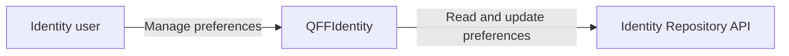

# QFFIdentity

## Overview

QFFIdentity is the customer app for managing personal preferences. The app is currently a starter; the requirements below are planned in the [canonical ontology implementation plan](../plan-canonical-ontology.md).

## Business context

Customers control what their preferences say. An inferred interpretation or an analyst's mapping decision does not count as customer approval.

| From | To | Interaction |
| --- | --- | --- |
| Identity user | QFFIdentity | Select and act as a simulated profile in testing. In production, view and edit their own preferences and approve proposed wording. |
| QFFIdentity | Identity Repository API | Read and update preferences for the selected test profile or the caller's resolved production profile, and submit customer approvals. |

## Functional Requirements

- Let customers view and edit their own preferences and review suggested wording before accepting it.
- Save accepted wording as a new preference linked to the inference. Keep the original preference; the customer may mark it as superseded.
- In the test environment only, let users select an internal profile ID and act as that simulated customer.

## Application Architecture

The browser reads and saves preferences through the Identity Repository API, which owns the source records. In production, the backend resolves the signed-in user's MSAL `oid` to a separate internal profile ID and limits access to that profile.

## Technical Guidance

- Use the app-local VS Code **Start** launcher or run `pnpm dev` from this folder (port 5181).
- Use stable preference GUIDs and handle revision conflicts without silently overwriting edits. Test that approving wording creates a new record and preserves the original.

## Design decisions

- Customer acceptance creates an independent preference linked to its inference; it never overwrites or deletes the existing preference. The customer may keep, replace, supersede, or contradict preferences.
- Preference confirmation belongs to QFFIdentity. Analyst approval of a concept or mapping in QFFModeler is not customer confirmation.
- Profile selection/impersonation is test-only. Production access uses the authenticated user's MSAL `oid` to resolve their internal profile and limits access to that profile.
