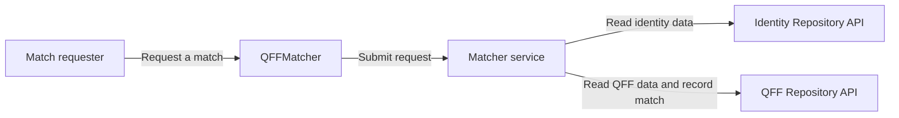

# QFFMatcher

## Overview

QFFMatcher is the customer app for requesting matches and viewing the permitted results. The app is currently a starter; the requirements below are planned in the [canonical ontology implementation plan](../plan-canonical-ontology.md).

## Business context

Customers want to discover compatible connections without seeing another person's private information. A useful explanation tells customers what matched using their own preferences or permitted de-identified aggregates.

| From | To | Interaction |
| --- | --- | --- |
| Match requester | QFFMatcher | Request a match and see only their own data or permitted de-identified aggregates. |
| QFFMatcher | Matcher service | Submit the match request and receive the result scoped to the requester. |
| Matcher service | Identity Repository API | Read only the identity data needed to compute the match. |
| Matcher service | QFF Repository API | Read matching inputs and save the match transaction. |

## Functional Requirements

- Let customers submit a match request for their profile and applicable pair scope, with optional current intent. Do not require a persona. Allow profile selection only in the test environment.
- Explain the result without exposing another person's preferences, affinities, or evidence that could identify them.

## Application Architecture

The browser calls the Matcher service, not the repositories. The service reads the minimum data it needs through the Identity and QFF Repository APIs, saves a match transaction through the QFF Repository API, then returns only what the requester is allowed to see.

## Technical Guidance

- Use the app-local VS Code **Start** launcher or run `pnpm dev` from this folder (port 5183).
- Enforce privacy in the service response, not by hiding fields in the browser. Test the response with simulated profiles.
- If scores are shown, label similarity and heuristic confidence separately. Show probability only when the service supplies it from an approved calibration.

## Design decisions

- In production, customers may access only their own data or permitted de-identified aggregates. Analysts access cross-identity data only through their authorized APIs; profile selection is a test-only facility.
- The Matcher reads the minimum required data through the repository APIs, persists a minimal QFF-owned match transaction before returning a result, and does not copy full identity profiles into that transaction.
- Use stable request/transaction IDs and idempotent retries so a retry does not create a duplicate logical match.
- Similarity is a retrieval/ranking signal; heuristic confidence is separate and versioned. Do not expose probability until an approved calibration is available.
