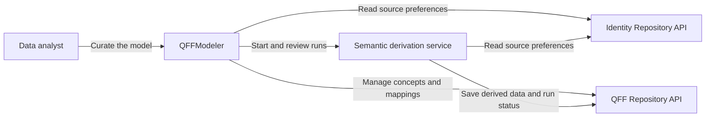

# QFFModeler

## Overview

QFFModeler is the analyst app for maintaining the shared concept catalogue and reviewing how preferences map to it. The app is currently a starter; the first release is scoped in [Phase 3 of the implementation plan](../plan-canonical-ontology.md#phase-3--qffmodeler-mvp-and-api-integration).

## Business context

Analysts use shared concepts to compare differently worded preferences without rewriting what customers said. Analysts can approve concepts and mappings, but only customers can confirm their own preference wording in [QFFIdentity](../QFFIdentity/readme.md).

| From | To | Interaction |
| --- | --- | --- |
| Data analyst | QFFModeler | Curate concepts and mappings, and start or review derivation runs. |
| QFFModeler | Identity Repository API | Read source preferences as modelling inputs within the analyst's authorization. |
| QFFModeler | QFF Repository API | Read and update canonical concepts, mappings, and modelling run records. |
| QFFModeler | Semantic derivation service | Start derivation runs and review their status and results. |
| Semantic derivation service | Identity Repository API | Read the source preferences needed for derivation. |
| Semantic derivation service | QFF Repository API | Save derived representations, mappings, their supporting evidence, and run status. |

## Functional Requirements

- Show the current catalogue version, latest derivation run, and counts of mapped, unmatched, and review items.
- Edit curated concepts and their relationships. Review inferred mappings with evidence, scores, and the model and catalogue versions used.
- Start a bounded derivation run, track its status, and inspect results and score distributions.

## Application Architecture

The browser reads authorized source preferences through the Identity Repository API and reads or updates concepts and mappings through the QFF Repository API. The semantic derivation service runs the jobs; the browser only starts and monitors them.

## Technical Guidance

- Use the app-local VS Code **Start** launcher or run `pnpm dev` from this folder (port 5182).
- Use AG Grid for editing and review tables and Plotly for charts. Keep one primary visualization per page except on the dashboard.
- Keep similarity and heuristic confidence separate and preserve version and evidence details when reviewing mappings. Probability calibration is later work.
