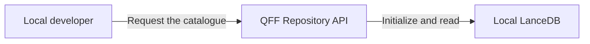

# QFF Repository

## Overview

The QFF Repository owns the active concept catalogue and QFF-derived data. Phase 1 implements a local LanceDB bootstrap and catalogue read API. Derived-data writes and client integrations are planned in the [canonical ontology implementation plan](../plan-canonical-ontology.md).

## Business context

Analysts need a shared catalogue and a way to inspect derived results without changing what customers said. The diagram shows the Phase 1 local flow; later, QFFViz and QFFModeler will use the API, as will the Matcher and semantic derivation services.

| From | To | Interaction |
| --- | --- | --- |
| Local developer | QFF Repository API | Request the active catalogue and see whether derived data is available. |
| QFF Repository API | Local LanceDB | Initialize the dataset on first access, then read the active catalogue version and concepts. |

## Functional Requirements

- **Implemented:** `GET /api/v1/catalogue` returns the active version, up to 100 concepts, and a `truncated` flag. The initial catalogue has no reviewed concepts, and `derived_data_stale` remains true because refresh is not implemented in Phase 1.
- **Implemented:** Keep an idempotent `identity_preference_refs` index of source identity IDs, preference IDs, and source revisions for downstream derivation. It does not duplicate identity profiles.
- **Planned:** Serve and persist canonical concepts, mappings, vectors, derivation runs, and minimal match transactions through the API. Keep identity source data in the [Identity Repository](../IdentityRepository/readme.md).

## Application Architecture

The TypeScript/Node.js Azure Functions app is the only runtime component that opens LanceDB. It bootstraps the local `.data/` dataset from the versioned schema and seed in [CanonicalModels](../CanonicalModels/). Those files initialize a dataset; they are not a second editable catalogue. The derivation and Matcher services will compute results outside the repository and persist them through its API.

## Technical Guidance

- With Azure Functions Core Tools installed, set `FUNCTIONS_WORKER_RUNTIME=node` and `QFF_FIXTURE_MODE=1` in your shell. From this folder, run `pnpm start` (port 7182, loopback only) or `pnpm test` for the repository tests.
- Use synthetic data only. The local dataset is disposable; a fresh dataset starts with an empty set of derived records. Production hosting and authorization are not implemented.

## Design decisions

- **One runtime owner:** Keep LanceDB access behind this API and link to identity records by stable IDs rather than copying source profiles.
- **Active model authority:** `CanonicalModels/` contains schemas, migrations, and seed/import artifacts only. The reviewed catalogue and its version history are QFF-owned runtime state.
- **Concept lifecycle:** Give concepts immutable IDs, definitions, optional aliases/examples/exclusions, typed relationships, lifecycle status, and a catalogue version. Only approved concepts participate in normal candidate retrieval; proposed concepts require review and retired concepts are excluded.
- **Derived mapping records:** Link each mapping to identity/preference and concept IDs. Preserve relationship type, provenance/evidence, score method and values, model/catalogue versions, and lifecycle status (`inferred`, `review`, `rejected`, `overridden`, or `superseded`) separately from source facts, analyst decisions, and customer confirmation.
- **Vector metadata:** Keep embeddings and their model/version/dimension metadata with QFF-derived records, never in identity source files.
- **Single-writer baseline:** Phase 1 serializes local bootstrap in one worker. Later write APIs start with one active writer; Pub/Sub and batching are deferred.
- **Dataset-level staleness:** Source edits or deletions invalidate derived data. Track staleness for the dataset, not each record; a user-triggered full backend refresh checks current inputs against the embedding cache and repairs stale data. Phase 1 does not perform that refresh.
- **Development data only:** The local LanceDB dataset is disposable and rebuildable from tracked source/seed inputs. Test data has no backup or retention requirement, and development logs may be rewritten; production hosting, authorization, backup, retention, and log forwarding need separate deployment decisions.
- **API consistency:** Use versioned JSON contracts, stable error responses, and optimistic revisions for edits. Long-running operations use stable run IDs and idempotent retries.
