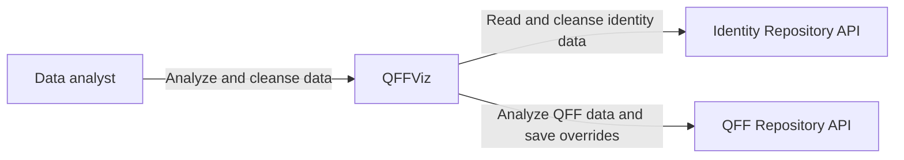

# QFFViz

## Overview

QFFViz is the existing analyst app for exploring QFF simulation data. Its planned API boundaries are described in the [canonical ontology implementation plan](../plan-canonical-ontology.md).

## Business context

Analysts use QFFViz to explore data across identities and find issues that need cleaning or an override. It is not the customer preference approval or matching app.

The diagram shows the planned repository API connections.

| From | To | Interaction |
| --- | --- | --- |
| Data analyst | QFFViz | Explore identity and QFF data across profiles, cleanse data, and edit overrides. |
| QFFViz | Identity Repository API | Read and cleanse identity data within the analyst's cross-profile authorization. |
| QFFViz | QFF Repository API | Read QFF-owned data for analysis and save analyst-approved overrides. |

## Functional Requirements

- Explore identities, personas, preferences, relationships, and embedding-based views.
- Let authorized analysts cleanse identity data and save QFF-owned overrides. An override does not count as customer confirmation.
- Show when derived data may be stale. After migration, use a dataset-level indicator and let a full update detect and repair stale data.

## Application Architecture

Today, the local app uses Vite middleware for fixture file access and embedding operations. The planned split routes identity reads and edits through the Identity Repository API and QFF data and overrides through the QFF Repository API. Matching and semantic derivation move to backend services; the browser does not open repository files or LanceDB.

## Technical Guidance

- Use the app-local VS Code **Start** launcher or run `pnpm dev` from this folder (port 5180).
- Treat current file and embedding routes as local development tooling, not production APIs. Do not copy them into other apps.
- Text changes invalidate the affected embedding. Follow the [shared QFF embedding rules](../Readme.md#embedding-text-changes-invalidate-vectors) rather than adding a separate refresh policy.
