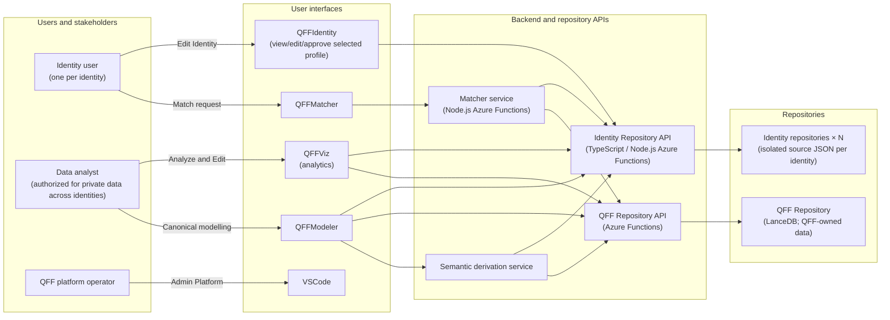

# Implementation plan: canonical preference ontology

## Purpose and status

This document turns [the evolutionary semantic ontology proposal](evolutionary-semantic-ontology-inference.md) into a staged technical plan. The proposal is implementable as a new semantic layer over QFF preferences; it must not rewrite customer terminology or treat existing interest-mode vectors as a complete subject ontology.

**Current stage: Phase 1 local repository foundations and fixture migration implemented.** Component-level contracts are documented in the relevant [Identity Repository](IdentityRepository/readme.md), [QFF Repository](QFFRepository/readme.md), [QFFIdentity](QFFIdentity/readme.md), [QFFMatcher](QFFMatcher/readme.md), and [QFFModeler](QFFModeler/readme.md) documentation. Keep the work MVP-sized: design, simulate, validate, and iterate before building later-phase functionality.

## Governing requirements

- Preserve identity-owned source preferences as authoritative JSON data. Store inferred interpretations separately; inference alone never makes a preference explicit.
- Keep hand-crafted concepts, definitions, relationships, and mapping overrides first-class. Automated discovery may propose changes, but a proposal does not become an approved canonical concept without review.
- Treat concepts as subject matter. The existing [`interest-modes.json`](interest-modes.json) describes *how* a person engages with an interest (participate, spectate, visit, etc.), not topics such as visual arts or outdoor recreation. Keep those models distinct unless an explicit reviewed mapping connects them.
- Use `embedding_similarity` only to retrieve/rank candidates; use versioned heuristic `confidence_score` for uncalibrated mapping evidence; use `probability` only after held-out empirical calibration. Never imply that a similarity or heuristic score is a likelihood.
- Preserve the matching privacy contract: analysts are authorized to access all identity data; customers may access only their own data and de-identified aggregate data. A customer's use of matching must not expose another customer's preference details, affinities, or uniquely identifying inferred evidence.
- A customer's acceptance of proposed wording creates a new preference; it does not rewrite the existing preference. The customer may keep, replace, supersede, or contradict preferences. Analyst approval of a concept or mapping is not customer confirmation.
- The current six identity fixtures are simulated, non-production data and may be updated by agents. Git-tracked stores and development security are not production controls.
- In the test environment, users may choose an internal profile ID and impersonate profiles as needed. This is not a production authorization model. In production, resolve the external MSAL `oid` through a separate lookup to the internal profile ID; do not use the external ID as the internal ID.

## Business context

The diagram shows high-level stakeholder and component connectivity only; it is not a sequence of interactions or a list of transactions.

### User-to-system interactions

| User | System | Interaction Description |
| --- | --- | --- |
| Identity user | QFFIdentity | In testing, select and impersonate a profile; in production, view, edit, and approve their own identity data. |
| Identity user / match requester | QFFMatcher | Request a match and receive their own data or de-identified aggregate information permitted for that requester. |
| Data analyst | QFFViz | Analyze all identity and QFF data, and perform data cleansing or override editing. |
| Data analyst / canonical modeler | QFFModeler | Curate canonical concepts and mappings, and review or trigger modelling runs. |
| QFF platform operator | Platform administration tooling | Administer the local development platform and its services. |

### UI-to-system-component interactions

| UI | System Component | Interaction Description |
| --- | --- | --- |
| QFFIdentity | Identity Repository API | Read and update the selected test profile, or the production identity resolved to the caller's internal profile ID; submit customer preference approvals. |
| QFFMatcher | Matcher service | Submit a match request and receive the requester's permitted result. |
| QFFViz | Identity Repository API | Read and cleanse identity data within the analyst's all-data authorization. |
| QFFViz | QFF Repository API | Analyze QFF-owned data and save analyst-approved overrides. |
| QFFModeler | Identity Repository API | Read identity preferences as modelling inputs within analyst authorization. |
| QFFModeler | QFF Repository API | Read and update canonical concepts, mappings, and modelling run records. |
| QFFModeler | Semantic derivation service | Trigger and review semantic derivation runs. |

In the test environment, a user selects an internal profile ID and may impersonate any fixture profile; this supports simulation and is not a security control. In production, the Identity Repository resolves the authenticated MSAL `oid` through a separate lookup to an internal profile ID. Customers may access only their own data or de-identified aggregates, while analysts are authorized to access all identity data through approved APIs. QFFViz accesses identity data through Identity Repository API and QFF-owned data through QFF Repository API. Customers review and approve preferences in the QFFIdentity; QFFModeler is for analysts and cannot confirm preferences on a customer's behalf.

## Score terminology

| Term | Contract |
| --- | --- |
| `embedding_similarity` | Vector similarity for candidate retrieval and semantic ranking; not a correctness likelihood. |
| `confidence_score` | Versioned, uncalibrated heuristic from one or more signals; for ranking, workflow thresholds, and review prioritization only. |
| `probability` | Empirically calibrated mapping-correctness estimate, reviewed and introduced in Phase 5 only after validation on held-out labelled outcomes. |

Store `embedding_similarity` and `confidence_score` separately with score method/version, embedding model/version, and taxonomy version. Any future `probability` must identify the calibration model, labelled dataset, relationship type, and taxonomy version; evaluate with calibration measures such as reliability curves and Brier score.

## Proposed implementation phases

The plan is deliberately incremental; phases remain requirements and proposed implementation notes, not a claim that future services already exist.

### Phase 1 — Identity Repository and QFF Repository foundations

#### Components and changes in this phase

| System component | Change |
| --- | --- |
| CanonicalModels | Add schemas, migrations, and initial seed/import artifacts for the canonical model. |
| Identity Repository | Build the TypeScript/Node.js Azure Functions API over tracked identity JSON; add stable GUID `preference_id` values, support test profile selection, and remove vector-only fields from source records. |
| QFF Repository | Build its Azure Functions API and rebuildable development LanceDB dataset; own the active catalogue, derived records, vectors, runs, and transactions. |
| Existing identity fixtures and migration tooling | Migrate source records without changing their meaning, verify IDs and preserved fields, and make the QFF-owned dataset rebuildable from tracked development inputs. |

#### Requirements

- Create the workspace foundations for the canonical model, identity source API, and QFF-owned LanceDB data.
- Keep identity JSON as the authoritative source in the development version; make the Identity Repository API the interface used by all clients/services.
- Establish persistent IDs and remove embeddings from identity-owned JSON without changing source preference meaning.
- Establish QFF Repository ownership over QFF data only, including vectors, and ensure development state can be rebuilt/reviewed from Git.
- Verify the migration preserves identity and preference source fields and stable IDs, removes vector-only identity fields, and rebuilds/restores the QFF-owned LanceDB dataset from tracked development inputs.
- Verify repository boundaries: test profile impersonation works through the selected internal profile ID; production customer and analyst access rules are enforced by approved APIs; only QFF Repository accesses LanceDB at runtime.

#### Technical implementation notes

- Create workspace folders for `CanonicalModels/`, `IdentityRepository/`, and `QFFRepository/`. Store schemas, migrations and seed/import artifacts in `CanonicalModels/`; do not maintain a second editable active catalogue there.
- Implement Identity Repository as a TypeScript/Node.js Azure Functions app with a development adapter over the existing Git-tracked identity JSON files. Keep its API separate from storage implementation so deployed file hosting can be swapped later.
- Preserve existing valid internal profile IDs. Add opaque GUID `preference_id` values once; ensure IDs survive edits to text, affinity, persona membership, or order. The test UI accepts a selected profile ID; production OID-to-profile lookup is a separate concern.
- Remove `embedding`, `kind_vectors`, `embedding_model`, and other vector-only fields from identity source files, while preserving keywords, definitions, kinds, affinities and source provenance.
- Implement the QFF Repository function app and initial LanceDB dataset. Store only QFF-owned canonical state, aggregates/references, vector records, derivation runs and matcher transactions; link identity records by IDs.
- Make the QFF Repository the active catalogue authority. Treat its development LanceDB dataset as disposable and rebuild it from tracked source and seed inputs; do not create backup or retention obligations for test data.
- Use revision checks and atomic source-file replacement for Identity Repository development writes; serialize QFF Repository writes and reject unsafe concurrent access. Source changes/deletions set the general staleness indicator for later full recomputation.
- Add focused tests for GUID assignment/stability, source-field preservation, removal of vector-only fields, revision handling, and repository boundaries. Test profile selection is a test feature, not production authorization.

#### Running the Phase 1 foundations locally

- In separate PowerShell terminals, set `$env:FUNCTIONS_WORKER_RUNTIME = "node"` and `$env:QFF_FIXTURE_MODE = "1"`, then run `pnpm --filter qff-identity-repository start` (7181) or `pnpm --filter qff-repository start` (7182). Use synthetic data only. Production authentication and hosting are not implemented.
- Identity API: `GET /api/v1/profiles`, `GET /api/v1/profiles/{profileId}`, and `PUT /api/v1/profiles/{profileId}/preferences/{preferenceId}`. For the edit, send the profile response's `revision` in `If-Match` and provide `keyword`, `definition`, `kind`, and `personas`. A stale revision returns `412`; reload before retrying.
- Fixture migration: `pnpm --filter qff-identity-repository migrate:fixtures` assigns missing GUIDs and removes preference vectors. It is safe to rerun. If a process crashes mid-write, verify that no writer is active before deleting any leftover per-file `.lock` or `.tmp` files.
- QFF API: `GET /api/v1/catalogue` initializes the local LanceDB dataset from the versioned schema and seed in `CanonicalModels/` and reads the active catalogue. The initial catalogue has no reviewed concepts. The dataset in `QFFRepository/.data/` is disposable; a fresh dataset starts with empty derived tables.
- QFFViz uses the Identity Repository for local profile reads. Legacy identity writes and vector features are paused rather than supported by a temporary storage path. [Phase 6](#phase-6--qffviz-redesign) records the impact and collects redesign work.

### Phase 2 — Semantic derivation, Matcher, and repository API integration

#### Components and changes in this phase

| System component | Change |
| --- | --- |
| Semantic derivation service | Build a headless pipeline that reads source through Identity Repository and writes envelopes, vectors, mappings, provenance, and run status through QFF Repository. |
| Matcher | Build a separate Azure Functions service that reads through both repositories, computes explainable privacy-safe matches, persists a minimal QFF transaction, and returns a requester-scoped response. |
| QFFIdentity and Identity Repository | Let the customer review and approve wording in the QFFIdentity; write each accepted wording as a new preference linked to its inference. The test UI accepts the selected profile ID; production uses the MSAL OID lookup. |
| QFF Repository | Provide the APIs and persistence needed for derived vectors/mappings, run tracking, and match transactions; serialize writes and support idempotent requests. |

#### Requirements

- Design, simulate and validate semantic mapping behavior against source identities before implementing the service.
- Generate semantic representations and mappings without modifying source preferences; persist all derived vectors/mappings in QFF Repository.
- Move matcher execution to a separate Node.js Azure Functions app. It must persist each match transaction through QFF Repository and return the permitted result to its requester.
- Provide explainable mapping/match paths, respect hand-authored controls, and keep source data private in per-requester outputs.
- Simulation must cover paraphrases, specificity, broader concepts, unrelated meanings, exclusions, rejected/overridden candidates, signed affinities and incompatible model metadata; results must retain enough provenance to explain mappings.
- Verify preference/kind vectors are rebuilt in LanceDB and keyed to the correct persistent IDs; source JSON remains unchanged except through authorized customer confirmation.
- Verify matcher reads through both repositories, persists the QFF-owned transaction before returning, and never includes counterpart details or uniquely identifying inferred evidence in a requestor's result.
- Verify embedding similarity and heuristic confidence remain distinct, versioned signals; no probability is exposed without held-out calibration evidence and metadata.

#### Technical implementation notes

- Depend on the Phase 1 Identity Repository API, QFF Repository API and LanceDB schema.
- Design envelopes from source keyword and definition; keep persona/affinity out of primary semantic embeddings. Use embeddings for candidate retrieval; combine other signals only in a versioned heuristic `confidence_score`.
- Simulate against the six synthetic identities plus edge cases for paraphrase, specificity, hierarchy, unrelated concepts, exclusions, rejected/overridden candidates and incompatible vector metadata. Revise before implementation.
- Build a headless derivation backend: read identity preferences through Identity Repository, regenerate preference/kind/concept vectors into QFF Repository, and persist mappings, provenance and run status there.
- Build Matcher as a separate Node.js Azure Functions app. It reads permitted identity data through Identity Repository and QFF aggregates/vectors through QFF Repository, computes explainable concept-based matches, persists a minimal transaction through QFF Repository, and returns a requester-scoped response.
- Retain direct preference-to-preference matching as an evaluation baseline. Keep kind, signed affinity and ontology relationship as distinct signals.
- Implement customer confirmation through the QFFIdentity and Identity Repository: accepting proposed wording creates a new preference linked to its inference; keep the prior preference independent and allow it to be marked superseded. Analyst overrides never imply customer consent.
- Use idempotent request/run identifiers and bounded operations so retries do not duplicate logical transactions. Avoid live Azure embedding calls in routine tests by using fixtures/cached vectors.
- Add focused derivation and Matcher tests for provenance, score terminology, privacy-safe responses, repository persistence, retries, and failure handling.

### Phase 3 — QFFModeler MVP and API integration

#### Components and changes in this phase

| System component | Change |
| --- | --- |
| QFFModeler | Build a separate analyst SPA for model overview, concept editing, mapping review, derivation runs, and score distributions. |
| Identity Repository and QFF Repository APIs | Expose only the analyst-authorized reads and edits needed by the UI; keep identity and QFF storage behind their respective APIs. Customer preference approvals remain in the QFFIdentity. |
| Semantic derivation service | Expose bounded run submission and status/results for the UI; keep execution on the backend. |
| QFFViz and QFFMatcher | Keep QFFViz focused on analyst analytics/cleansing and analyst overrides through QFF Repository API. Keep customer matching in the QFFMatcher; neither UI becomes the customer preference-approval surface. |

#### Requirements

- Deliver a small analyst-facing canonical modelling UI, separate from QFFViz analytics and customer-facing preference confirmation.
- Use a SPA/API boundary; invoke modelling/matcher execution through backend APIs and access identity/QFF-owned data through their respective repositories.
- Provide only the minimum pages needed to inspect current model state, edit curated concepts, review mappings, trigger derivation, and understand heuristic score distributions.
- Use AG Grid for tabular reporting/editing and Plotly for graphs. Keep each non-dashboard page focused on one primary visualization.
- Verify all pages use authorized APIs, do not access identity files or LanceDB directly, and keep modeling execution out of browser code. Do not add customer preference approval to the analyst UI.
- Verify analyst edits preserve version/provenance, do not impersonate customer consent, and display similarity/confidence without implying probability.
- Keep QFFViz analyst overrides distinct from customer confirmation; customer preference approval remains in the QFFIdentity.

#### Technical implementation notes

- Build a separate Node.js SPA with server/API separation so backend operations can later move to Azure Functions without redesigning the client. Do not access identity files or LanceDB directly from UI code.
- MVP pages:
  1. **Model overview dashboard:** current model/catalogue versions, last run, mapped/review/unmatched counts, and recent run/transaction status; compact AG Grid summary/history is appropriate on this dashboard.
  2. **Canonical concept editor:** AG Grid editing for labels, definitions, aliases, examples, exclusions, typed parent relationships and lifecycle status, with validation and versioned save.
  3. **Mapping review:** AG Grid filtering/sorting of inferred, review, rejected and overridden mappings; show stable IDs, relationship, `embedding_similarity`, heuristic `confidence_score`, score/model/catalogue versions and concise evidence. Analyst actions remain distinct from customer confirmation.
  4. **Derivation runs:** select source/catalogue/model versions, start a bounded backend run, and inspect progress/failure/results in an AG Grid table. No embedding/clustering execution in browser.
  5. **Score distribution:** one Plotly chart for similarity/confidence distributions and threshold exploration; clearly label all uncalibrated values as heuristic.
- Use Identity Repository for identity-owned views/edits and QFF Repository for canonical and derived data. Only authorized APIs may start derivation or matcher jobs.

### Phase 4 — QFF Repository, derivation, and Modelling UI enhancements

#### Components and changes in this phase

| System component | Change |
| --- | --- |
| QFF Repository | Add version history, reversible review decisions, calibration metadata, and retained prior mappings as approved lifecycle needs emerge. Add Pub/Sub and batched updates after the serialized single-writer baseline is established. |
| Semantic derivation service | Add unmatched-pattern discovery, clustering proposals, and version-aware remapping; never publish proposed concepts automatically. |
| QFFModeler | Add model comparisons, concept merge/split workflows, batch review, provenance, remapping impact, and calibration diagnostics when justified. |
| QFFIdentity and Identity Repository | Keep customer preference review/approval in the QFFIdentity; acceptance creates a new preference with the accepted wording and never overwrites the old one. |
| Hosted identity storage, LanceDB hosting, and operations | Keep production hosting, isolation, encryption, backups, retention, and scale-out as separate deployment work; validate these before production use rather than assuming Phase 4 implements them. |

#### Requirements

- Expand only after MVP evaluation confirms the service boundaries and analyst workflow.
- Add review and discovery capabilities without autonomous publication or silent changes to human-approved model state.
- Prepare reviewed labels and calibration diagnostics for the later probability lifecycle; do not expose `probability` in this phase.
- Verify clusters only propose concepts, approved changes create new model versions, and remapping retains prior results and explains changes.
- Before hosted production use, verify independently secured identity repositories, deletion propagation, QFF-only encrypted LanceDB access, and independent backup/retention behavior.

#### Technical implementation notes

- Add unmatched-pattern/clustering suggestions, version comparisons, compare/merge/split workflows, batch review, reversible overrides, provenance detail and remapping impact reports.
- Add separate focused Plotly pages for model changes, concept coverage, mapping quality and (if justified) calibration diagnostics; use separate AG Grid pages for their records.
- Recompute affected mappings when source/model/scoring/taxonomy changes, retaining prior versions and explaining the change.
- Use the QFFIdentity to collect customer approval and write each accepted wording as a new preference through Identity Repository. The technical analyst UI may show aggregate confirmation status but cannot impersonate customer consent.
- Defer production identity isolation, hosted LanceDB, independent backups, encryption and operational scale-out until the hosted-solution phase.

### Phase 5 — Probability calibration review and updates

#### Components and changes in this phase

| System component | Change |
| --- | --- |
| QFF Repository | Store labelled evaluation outcomes and versioned calibration models with their dataset, relationship type, taxonomy, and scoring metadata. |
| Semantic derivation service | Calibrate heuristic mapping scores against held-out reviewed outcomes and periodically reassess/update calibration as more labels become available. |
| QFFModeler | Add a calibration review workflow showing reliability curves, Brier score, sample coverage, and version comparisons; let authorized analysts approve or reject proposed calibration updates. |
| Matcher | Consume only an approved calibration version when returning `probability`; otherwise continue returning similarity and heuristic confidence only. |

#### Requirements

- Begin only when a sufficiently useful reviewed and labelled dataset is available; define the minimum sample and acceptance gates as part of this phase.
- Evaluate calibration on held-out outcomes using reliability curves, Brier score, and appropriate relationship/taxonomy slices.
- Keep `embedding_similarity`, heuristic `confidence_score`, and calibrated `probability` distinct in storage, APIs, and UI.
- Record the calibration model, labelled dataset, relationship type, taxonomy version, and evaluation results for each approved probability version.
- Re-review calibration as additional labelled data accumulates; retain versioned calibration history needed to compare, roll back, or replace a model.
- Do not expose probability when evaluation fails or an approved calibration version is unavailable.

#### Technical implementation notes

- Use reviewed mappings and outcomes as labels; prevent evaluation leakage by separating calibration/training data from held-out evaluation data.
- Keep the calibration procedure reproducible and versioned. Routine tests use fixtures and cached scores, not live embedding calls.
- Treat approval of a calibration model as an analyst decision; it does not change source preferences or independently approve canonical concepts.

### Phase 6 — QFFViz redesign

Collect QFFViz redesign changes here so they can be prioritized together. The first work item is recovery from the Phase 1 repository migration. Vector-dependent work uses the rebuilt vectors and APIs delivered in Phase 2.

#### Work item: Recover from the Phase 1 repository migration

| Area | Change and impact |
| --- | --- |
| Identity fixtures | Assigned stable GUIDs to 162 preferences across six profiles. Removed preference and kind vectors and embedding metadata without changing the other source fields. Legacy vector views no longer have data in the identity JSON. |
| Profile reads and edits | QFFViz's local `GET /api/files` now adapts Identity Repository API responses for existing profile views. `PUT /api/files` returns `405`, so the Raw JSON and preference editors can no longer save through that route. The Identity Repository already exposes revision-checked preference updates. |
| Vector tools | The legacy `/api/embeddings` routes return `503`. The old refresh/status tools, heatmaps, similarity plots, keyword maps, and match preview are disabled or lack data. These are examples of the impact, not a feature restoration checklist. |

#### Components and changes in this phase

| System component | Change |
| --- | --- |
| QFFViz | Redesign a small set of analyst workflows for exploration, data cleansing, and approved overrides. Remove or replace obsolete pages and retire the temporary profile adapter as the new views take over. |
| Identity Repository API | Reuse authorized profile reads and revision-checked preference edits for source-data cleansing. Add only operations required by the agreed workflows; do not restore a raw file editor. |
| QFF Repository API and semantic derivation service | Use repository APIs for derived analytics and analyst overrides, and backend derivation for refreshes. Add only missing endpoints needed by the selected workflows. If an analyst match preview is retained, call the Matcher service rather than computing matches in QFFViz. |

#### Requirements

- Choose which analyst tasks to support before designing pages. Use legacy pages only to identify what was interrupted, not as requirements for the replacement.
- Keep source edits in the Identity Repository and vectors and QFF-owned overrides in the QFF Repository. QFFViz must not read or write repository files or LanceDB, run derivation, or approve preferences on a customer's behalf.
- Show dataset-level staleness and clear states for missing, rebuilding, or failed derived data. A full update runs on the backend; the UI reloads results when it completes.
- Verify on simulated profiles that an analyst can read data, save a permitted edit with revision checking, and view rebuilt analytics after a backend refresh without restoring vectors to identity JSON.

## Decisions requiring follow-up

Production identity security, hosting, backup, retention, and log forwarding remain deployment work. Exact semantic-envelope wording, retrieval limits, heuristic weights, and review thresholds are left to Phase 2 design/simulation and must be versioned and evaluated on reviewed examples. Probability calibration gates are defined in Phase 5. Advanced time-series/context-aware analysis of changing or contradictory preferences is deferred until a sufficiently large longitudinal dataset is available.

## Recommended immediate milestone

Use the Phase 1 repository APIs and rebuildable local dataset to design and simulate Phase 2 before building the services. Build the Phase 3 MVP only after those service contracts are exercised. Add repository Pub/Sub/batching in a later phase, and begin Phase 5 calibration only when sufficient reviewed labels exist.

## Application Architecture

The following runtime components expand the business context diagram. Stakeholder roles are actors, not application components. Browser UIs call the APIs and services below; they do not read repository files, open LanceDB, or run semantic derivation themselves.

### User interfaces and administration

| Component | Purpose |
| --- | --- |
| QFFIdentity | Lets customers view and edit preferences and check/approve proposed wording. In testing, the user selects an internal profile ID and may impersonate profiles; in production, access is limited to the caller's profile. |
| QFFMatcher | Lets a customer submit a match request and see only their own data or permitted de-identified aggregate information. |
| QFFViz | Provides analyst analytics and data cleansing across identity and QFF data. It reads through both repository APIs and saves analyst-approved QFF overrides through QFF Repository API. |
| QFFModeler | Lets analysts curate canonical concepts, review mappings, inspect runs and scores, and trigger backend derivation. It does not confirm preferences on a customer's behalf. |
| VS Code platform administration | Provides the QFF platform operator's local development and service-administration tooling. |

### Backend services and repository APIs

| Component | Purpose and ownership |
| --- | --- |
| Identity Repository API | The sole API for identity-owned source JSON. It reads/writes each identity repository and handles preference updates and customer approvals. Test requests may select an internal profile ID; production resolves the external MSAL `oid` through a separate lookup to the internal profile ID. |
| QFF Repository API | The sole runtime API for QFF-owned data and the only component that opens LanceDB. It owns the active canonical model, derived mappings/vectors, run metadata, and match transactions. Writes begin serialized with one active writer; Pub/Sub and batching are later enhancements. |
| Matcher service | A Node.js Azure Functions service that reads the minimum required identity and QFF data through their APIs, computes an explainable match, persists its transaction through QFF Repository API, and returns a requester-scoped response. |
| Semantic derivation service | A headless backend that reads source preferences through Identity Repository API and writes semantic representations, vectors, mappings, provenance, and run status through QFF Repository API. |

### Data repositories

| Component | Purpose and ownership |
| --- | --- |
| Identity repositories × N | Isolated JSON source records, one per internal profile. These are the authoritative identity-owned preferences and are accessed at runtime only through Identity Repository API. |
| QFF Repository (LanceDB) | QFF-owned canonical-model state, derived records and vectors, run data, and match transactions. It does not own or replace identity source preferences and is accessed at runtime only through QFF Repository API. |

### Design-time assets

`CanonicalModels/` contains schemas, migrations, and seed/import artifacts used to initialize or evolve the active model. It is not a second editable runtime catalogue; the active reviewed model is owned by QFF Repository.

### Technical guidance

- Implement only the current phase's smallest useful increment. Prefer a thin end-to-end slice, simulate and validate it, then expand; leave later-phase work deferred until its phase. It's ok to do multiple iterations in phase.
- Preserve repository ownership boundaries: identity source JSON is accessed through Identity Repository API, and QFF data/LanceDB through QFF Repository API. No UI or service opens either store directly.
- Keep backend operations headless and serverless-compatible. Use explicit, versioned API contracts and bounded, idempotent operations wherever retries are possible.
- Treat test profile selection/impersonation and tracked development data as test-only; production identity resolution and customer access boundaries are separate requirements described above.
- Add focused automated tests for behavior introduced in each phase. Use simulated identities and cached embedding fixtures so routine tests do not require live Azure calls.
- Keep changes surgical, record design decisions in the appropriate component/phase documentation, and leave future work explicit rather than adding speculative abstractions.
