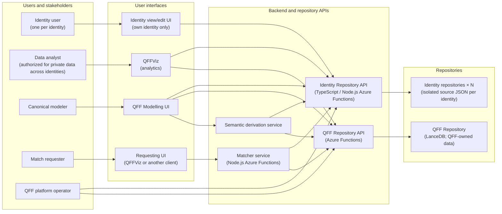

# First-take plan: canonical preference ontology

## Purpose and status

This document turns [the evolutionary semantic ontology proposal](evolutionary-semantic-ontology-inference.md) into a staged technical plan. The proposal is implementable as a new semantic layer over QFF preferences; it must not rewrite customer terminology or treat existing interest-mode vectors as a complete subject ontology.

**Current stage: Phase 0 technical design.** Use this phase to ratify contracts and resolve the few questions that cannot be answered from the existing requirements. Keep the work MVP-sized: design, simulate, validate, and iterate before building later-phase functionality.

## Governing requirements

- Preserve identity-owned source preferences as authoritative JSON data. Store inferred interpretations separately; inference alone never makes a preference explicit.
- Keep hand-crafted concepts, definitions, relationships, and mapping overrides first-class. Automated discovery may propose changes, but a proposal does not become an approved canonical concept without review.
- Treat concepts as subject matter. The existing [`interest-modes.json`](interest-modes.json) describes *how* a person engages with an interest (participate, spectate, visit, etc.), not topics such as visual arts or outdoor recreation. Keep those models distinct unless an explicit reviewed mapping connects them.
- Use `embedding_similarity` only to retrieve/rank candidates; use versioned heuristic `confidence_score` for uncalibrated mapping evidence; use `probability` only after held-out empirical calibration. Never imply that a similarity or heuristic score is a likelihood.
- Preserve the matching privacy contract: per-party results must not expose the counterpart's preference details, affinities, or uniquely identifying inferred evidence. A preference's use for matching is not permission to disclose it.
- Only a customer's explicit selection promotes an inferred preference into that identity's source JSON. Analyst approval of a concept or mapping is not customer confirmation.
- The current six identity fixtures are simulated, non-production data and may be updated by agents. Git-tracked stores and development security are not production controls.

## Business context

The diagram shows high-level stakeholder and component connectivity only; it is not a sequence of interactions or a list of transactions.

Each identity user is restricted to their own identity repository through the Identity view/edit UI. The data analyst has explicit authorization to access private data across all identity repositories; QFFViz accesses them through Identity Repository API and also connects to QFF Repository API. The canonical modeler uses the Modelling UI, and match requesters use an authorized requesting UI. Operators administer the APIs and repositories under their operational role.

## Score terminology

| Term | Contract |
| --- | --- |
| `embedding_similarity` | Vector similarity for candidate retrieval and semantic ranking; not a correctness likelihood. |
| `confidence_score` | Versioned, uncalibrated heuristic from one or more signals; for ranking, workflow thresholds, and review prioritization only. |
| `probability` | Empirically calibrated mapping-correctness estimate, introduced only after validation on held-out labelled outcomes. |

Store `embedding_similarity` and `confidence_score` separately with score method/version, embedding model/version, and taxonomy version. Any future `probability` must identify the calibration model, labelled dataset, relationship type, and taxonomy version; evaluate with calibration measures such as reliability curves and Brier score.

## Proposed implementation phases

The plan is deliberately incremental. QFF is currently in Phase 0 technical design; phases below are requirements and proposed implementation notes, not a claim that future services already exist.

### Phase 0 — Technical design and contracts (current phase)

#### Requirements

- Agree on source-of-truth and service ownership before building repository or modeling functionality.
- Define data schemas and API contracts sufficient to implement Phase 1 without locking later phases into a premature scoring model.
- Separate identity-owned source edits, analyst-owned model edits, derived inference, customer confirmation, and match transactions.
- Define a small simulation/acceptance set that allows fast iteration on semantic mapping and privacy.
- Ratify identity-user access to only their own source repository and the data analyst's explicit access to private data across identities through QFFViz and repository APIs.
- Confirm ID, schema, API authorization/concurrency, evidence visibility, transaction retention, deletion propagation, and calibration contracts or record the unresolved question and a Phase 1-safe default.
- Review the proposed concept/mapping lifecycle and confirm that no inferred result becomes explicit without customer selection and no heuristic score is represented as probability.

#### Technical implementation notes

| Area | Proposed contract based on available requirements |
| --- | --- |
| Identity Repository | TypeScript on Node.js/Azure Functions owns all identity JSON reads/writes. Its development adapter uses Git-tracked identity files; a future deployed adapter may use alternative file hosting. No other frontend/backend reads those files directly. |
| QFF Repository | A separate function app owns QFF-controlled canonical-model state, derived mappings, preference/kind/concept vectors, run metadata, and match transactions in LanceDB. It may keep preference aggregates keyed by identity/preference IDs, but not identity source truth. It is the only runtime service opening the non-multi-user LanceDB files. |
| Persistent identifiers | Preserve each valid existing `identity_id`. Add an opaque, immutable `preference_id` to every preference; generate once during migration (proposed UUID), persist in identity JSON, and never derive it from mutable wording or array position. Use those IDs for QFF Repository links. |
| Embedding lifecycle | Phase 1 removes preference embeddings, kind vectors, and embedding-only metadata from identity JSON. Phase 2 recreates required vectors in QFF Repository LanceDB from current source and model inputs. Model name/version/dimensions belong with derived records, not identity source. |
| Canonical model authority | Keep `CanonicalModels/` for schemas, migrations and initial seed/import artifacts. The active, reviewed model and its version history are QFF-owned state managed through QFF Repository; avoid a second independently editable catalogue source. Commit development LanceDB files in QFF Git until hosted deployment. |
| Concept schema | Each concept has an immutable `concept_id`, label, definition, optional aliases/examples/exclusions, typed parent/related links, lifecycle status and catalogue version. Distinguish proposed, approved and retired concepts; only approved concepts participate in normal candidate retrieval. |
| Mapping schema | Each derived mapping links identity/preference ID to concept ID and records relationship type, `embedding_similarity`, optional heuristic `confidence_score`, score method/version, evidence/provenance, model/catalogue versions and lifecycle status. Keep source facts, analyst decisions and customer confirmation as distinct records/events. |
| Service/API ownership | Identity Repository is the only identity-source API; QFF Repository is the only LanceDB API. Matcher and derivation services call both as needed. QFFViz and the Modelling UI call APIs; neither opens data files or executes backend modeling in the browser. |
| Mapping lifecycle | Store inferred candidates separately from source. Suggested states: inferred, review, rejected, overridden, and superseded; preserve evidence and model/catalogue versions. Analyst overrides are QFF-owned. Only customer confirmation, written through Identity Repository, makes a preference explicit. |
| Score contract | Store `embedding_similarity` separately from heuristic `confidence_score`; version the heuristic. Do not emit `probability` until an empirically calibrated model passes held-out evaluation. |
| Matcher contract | A request identifies the requester and pair/persona scope. Matcher reads the minimum required identity/QFF data, computes a privacy-safe result, persists a QFF-owned transaction, and returns only the requestor's permitted view. Do not persist a duplicate of full identity profiles in the transaction. |
| API behavior | Use versioned JSON request/response contracts, stable error responses, caller authorization, and optimistic revisions for source/model edits. Give long-running derivation requests stable run IDs and retries idempotent behavior; a successful matcher response follows persistence of its QFF transaction. |
| Execution/deployment | Use TypeScript/Node.js Azure Functions for repository and matcher APIs, consistent with workspace standards. Keep handlers callable headlessly. Development may use local tracked data and function emulation; production hosting/security is future work. |

#### Phase 0 clarification required

The following cannot be determined confidently from current files/requirements. Confirm during the current technical design; proposed defaults are recorded to make discussion concrete:

1. **Preference ID format:** accept opaque UUIDs for new `preference_id` values, or align with another workspace-wide ID convention? Existing valid `identity_id` values will be retained.
2. **Identity API authorization:** which caller identity and authorization mechanism should protect customer-scoped writes versus technical-analyst edits? Proposed default: distinct roles, deny-by-default, and no client-supplied identity ID treated as proof of ownership.
3. **Identity file concurrency:** should the development adapter use revision/ETag compare-and-swap and atomic file replacement? Proposed default: yes, reject stale writes rather than silently overwrite.
4. **LanceDB concurrency/hosting:** what lock/singleton strategy and file system will be used when Azure Functions can scale out? Proposed default: one active writer with serialized mutations; do not scale out direct file access. This must be resolved before hosted deployment.
5. **Confirmation semantics:** when a customer confirms a canonical inference, should Identity Repository add a new preference using the canonical label/definition, or require customer-edited wording/definition? In either case, preserve existing preferences and record the confirmed mapping provenance.
6. **Matcher transaction retention:** what retention period and fields are required for an auditable match transaction? Proposed default: persist request/run IDs, relevant model versions and the minimum result/evidence necessary; avoid copying source profiles or counterpart details.
7. **Production privacy lifecycle:** what are the required identity deletion, derived-vector purge, backup, and audit-retention guarantees when the simulated system becomes hosted? Define before production data is used.
8. **Calibration acceptance:** what minimum labelled sample size and calibration gates are acceptable before exposing `probability`? Until agreed and validated, use heuristic scores only.
9. **Match evidence visibility:** which explanations may a technical analyst see, and what may a customer see in their own result? Proposed default: analysts see source-linked evidence only for authorized work; customer responses contain only the requestor's own source details and generic reasons, never counterpart text, affinities or uniquely identifying inferred mappings.
10. **Revision/deletion propagation:** when an identity preference changes or is deleted, what is the expected timing for marking its QFF aggregates/vectors/mappings stale or purging them? Proposed default: invalidate derived records immediately on a source revision, rebuild before using them, and propagate deletion to derived data; retain a transaction only if the retention policy permits it and it no longer exposes deleted source data.
11. **Initial scoring inputs:** should the initial heuristic include explicit text evidence and ontology support in addition to `embedding_similarity`? Proposed default: record signals separately, start with similarity plus directly supported evidence and typed ontology links, keep persona affinity out of semantic mapping, and tune weights/thresholds in Phase 2 simulation.
12. **Customer confirmation authorization:** should customer confirmation be available only through a future customer-facing UI/API, or does another authorized product surface exist? Proposed default: do not expose an analyst impersonation path; implement the source-repository operation but defer customer UI until an authorized surface is identified.

### Phase 1 — Local workspace and repositories

#### Requirements

- Create the workspace foundations for the canonical model, identity source API, and QFF-owned LanceDB data.
- Keep identity JSON as the authoritative source in the development version; make the Identity Repository API the interface used by all clients/services.
- Establish persistent IDs and remove embeddings from identity-owned JSON without changing source preference meaning.
- Establish QFF Repository ownership over QFF data only, including vectors, and ensure development state can be rebuilt/reviewed from Git.
- Verify the migration preserves identity and preference source fields and stable IDs, removes vector-only identity fields, and rebuilds/restores the QFF-owned LanceDB dataset from tracked development inputs.
- Verify repository boundaries: identity users cannot access another identity's source, while the explicitly authorized analyst can access all identity repositories through approved APIs; only QFF Repository accesses LanceDB at runtime.

#### Technical implementation notes

- Create workspace folders for `CanonicalModels/`, `IdentityRepository/`, and `QFFRepository/`. Store schemas, migrations and seed/import artifacts in `CanonicalModels/`; do not maintain a second editable active catalogue there.
- Implement Identity Repository as a TypeScript/Node.js Azure Functions app with a development adapter over the existing Git-tracked identity JSON files. Keep its API separate from storage implementation so deployed file hosting can be swapped later.
- Preserve existing valid `identity_id` values. Add opaque `preference_id` values once, using the confirmed Phase 0 format; ensure IDs survive edits to text, affinity, persona membership, or order.
- Remove `embedding`, `kind_vectors`, `embedding_model`, and other vector-only fields from identity source files, while preserving keywords, definitions, kinds, affinities and source provenance.
- Implement the QFF Repository function app and initial LanceDB dataset. Store only QFF-owned canonical state, aggregates/references, vector records, derivation runs and matcher transactions; link identity records by IDs.
- Make the QFF Repository the active catalogue authority. Commit development LanceDB files in the QFF Git repository for now; hosted deployment moves them out of Git and backs them up independently.
- Use revision checks and atomic source-file replacement for Identity Repository development writes if approved in Phase 0; serialize QFF Repository writes and reject unsafe concurrent access.

### Phase 2 — Semantic derivation and matcher services

#### Requirements

- Design, simulate and validate semantic mapping behavior against source identities before implementing the service.
- Generate semantic representations and mappings without modifying source preferences; persist all derived vectors/mappings in QFF Repository.
- Move matcher execution to a separate Node.js Azure Functions app. It must persist each match transaction through QFF Repository and return the permitted result to its requester.
- Provide explainable mapping/match paths, respect hand-authored controls, and keep source data private in per-requester outputs.
- Simulation must cover paraphrases, specificity, broader concepts, unrelated meanings, exclusions, rejected/overridden candidates, signed affinities and incompatible model metadata; results must retain enough provenance to explain mappings.
- Verify preference/kind vectors are rebuilt in LanceDB and keyed to the correct persistent IDs; source JSON remains unchanged except through authorized customer confirmation.
- Verify matcher reads through both repositories, persists the QFF-owned transaction before returning, and never includes counterpart details or uniquely identifying inferred evidence in a requestor's result.
- Verify embedding similarity and heuristic confidence remain distinct, versioned signals; no probability is exposed without held-out calibration evidence and metadata.

#### Technical implementation notes

- Depend on the Phase 1 Identity Repository API, QFF Repository API and LanceDB schema.
- Design envelopes from source keyword and definition; keep persona/affinity out of primary semantic embeddings. Use embeddings for candidate retrieval; combine other signals only in a versioned heuristic `confidence_score`.
- Simulate against the six synthetic identities plus edge cases for paraphrase, specificity, hierarchy, unrelated concepts, exclusions, rejected/overridden candidates and incompatible vector metadata. Revise before implementation.
- Build a headless derivation backend: read identity preferences through Identity Repository, regenerate preference/kind/concept vectors into QFF Repository, and persist mappings, provenance and run status there.
- Build Matcher as a separate Node.js Azure Functions app. It reads permitted identity data through Identity Repository and QFF aggregates/vectors through QFF Repository, computes explainable concept-based matches, persists a minimal transaction through QFF Repository, and returns a requester-scoped response.
- Retain direct preference-to-preference matching as an evaluation baseline. Keep kind, signed affinity and ontology relationship as distinct signals.
- Expose explicit customer confirmation through Identity Repository only after an authenticated customer selects a candidate. Record the source preference and link to the inference; analyst overrides never imply customer consent.
- Use idempotent request/run identifiers and bounded operations so retries do not duplicate logical transactions. Avoid live Azure embedding calls in routine tests by using fixtures/cached vectors.

### Phase 3 — QFF Modelling UI MVP

#### Requirements

- Deliver a small analyst-facing canonical modelling UI, separate from QFFViz analytics and customer-facing preference confirmation.
- Use a SPA/API boundary; invoke modelling/matcher execution through backend APIs and access identity/QFF-owned data through their respective repositories.
- Provide only the minimum pages needed to inspect current model state, edit curated concepts, review mappings, trigger derivation, and understand heuristic score distributions.
- Use AG Grid for tabular reporting/editing and Plotly for graphs. Keep each non-dashboard page focused on one primary visualization.
- Verify all pages use authorized APIs, do not access identity files or LanceDB directly, and keep modeling execution out of browser code.
- Verify analyst edits preserve version/provenance, do not impersonate customer consent, and display similarity/confidence without implying probability.

#### Technical implementation notes

- Build a separate Node.js SPA with server/API separation so backend operations can later move to Azure Functions without redesigning the client. Do not access identity files or LanceDB directly from UI code.
- MVP pages:
  1. **Model overview dashboard:** current model/catalogue versions, last run, mapped/review/unmatched counts, and recent run/transaction status; compact AG Grid summary/history is appropriate on this dashboard.
  2. **Canonical concept editor:** AG Grid editing for labels, definitions, aliases, examples, exclusions, typed parent relationships and lifecycle status, with validation and versioned save.
  3. **Mapping review:** AG Grid filtering/sorting of inferred, review, rejected and overridden mappings; show stable IDs, relationship, `embedding_similarity`, heuristic `confidence_score`, score/model/catalogue versions and concise evidence. Analyst actions remain distinct from customer confirmation.
  4. **Derivation runs:** select source/catalogue/model versions, start a bounded backend run, and inspect progress/failure/results in an AG Grid table. No embedding/clustering execution in browser.
  5. **Score distribution:** one Plotly chart for similarity/confidence distributions and threshold exploration; clearly label all uncalibrated values as heuristic.
- Use Identity Repository for identity-owned views/edits and QFF Repository for canonical and derived data. Only authorized APIs may start derivation or matcher jobs.

### Phase 4 — Modelling and review enhancements

#### Requirements

- Expand only after MVP evaluation confirms the service boundaries and analyst workflow.
- Add review and discovery capabilities without autonomous publication or silent changes to human-approved model state.
- Add calibration only when reviewed data and evaluation gates are sufficient.
- Verify clusters only propose concepts, approved changes create new model versions, and remapping retains prior results and explains changes.
- Add `probability` only when calibration is validated on held-out labelled data and its model, dataset, relationship type and taxonomy versions are recorded.
- Before hosted production use, verify independently secured identity repositories, deletion propagation, QFF-only encrypted LanceDB access, and independent backup/retention behavior.

#### Technical implementation notes

- Add unmatched-pattern/clustering suggestions, version comparisons, compare/merge/split workflows, batch review, reversible overrides, provenance detail and remapping impact reports.
- Add separate focused Plotly pages for model changes, concept coverage, mapping quality and (if justified) calibration diagnostics; use separate AG Grid pages for their records.
- Recompute affected mappings when source/model/scoring/taxonomy changes, retaining prior versions and explaining the change.
- Add a customer-facing confirmation flow only when that product UI exists; write selected preferences through Identity Repository. The technical analyst UI may show aggregate confirmation status but cannot impersonate customer consent.
- Defer production identity isolation, hosted LanceDB, independent backups, encryption and operational scale-out until the hosted-solution phase.

## Coding-agent guidance (including Ponytail agents)

- Implement only the current phase's smallest useful increment. Inspect contracts first, build a thin end-to-end slice, simulate it, validate it, and iterate; do not implement every service or UI page in one pass.
- Treat identity JSON as source of truth behind Identity Repository. Treat QFF Repository as owner of QFF data and derived vectors. Never open those stores directly from QFFViz, Modelling UI, derivation or Matcher code.
- Keep QFFViz focused on analyst analytics/cleansing; distinguish technical analyst overrides from customer confirmation.
- Keep backend operations headless and serverless-compatible, API contracts explicit, QFF Repository writes serialized, and operations idempotent where retried.
- Use AG Grid for tables/editing and Plotly for graphs. Prefer focused single-visualization pages, except the dashboard.
- Add focused tests for IDs, schemas, API ownership, persistence, provenance, score language, privacy, retries and failure handling. Use simulated identities/cached embeddings; routine tests must not need live Azure calls.
- Never label `embedding_similarity` or heuristic `confidence_score` as probability. Add calibrated probability only after held-out validation and metadata requirements pass.
- Keep changes surgical, document implemented decisions, and leave future-phase work as explicit follow-up rather than speculative abstractions.

## Decisions requiring follow-up

The numbered Phase 0 questions are the outstanding contracts requiring product/technical-design confirmation. Exact semantic-envelope wording, retrieval limits, heuristic weights and review thresholds are intentionally left to Phase 2 design/simulation; they must be versioned and evaluated on reviewed examples rather than fixed as probabilities from proposal examples or synthetic fixtures alone.

## Recommended immediate milestone

Complete Phase 0 design by ratifying its proposed defaults and answering the explicit clarification questions. Then implement only Phase 1 repository foundations and ID/vector migration. Use the resulting local dataset to design and simulate Phase 2 before building the services; build the Phase 3 MVP only after those service contracts are exercised.
