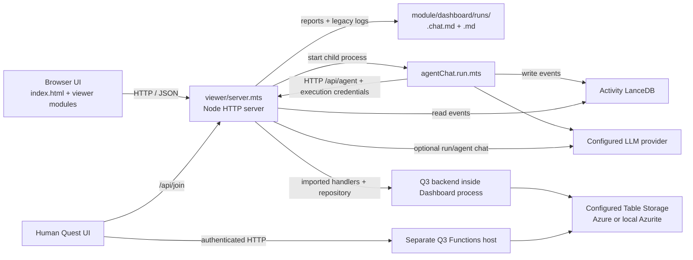

# Agent Lab Viewer Architecture

The Q3 Agent Lab viewer is a local monitoring and replay UI for the Quest3
agent-chat test harness. It is a small Node.js HTTP server plus browser-native
JavaScript modules; it is not part of the deployed React application. The
dashboard presents each run's activity, participants, metrics, findings, judge
results, relationships, questions, and chat in one interface.

## Runtime shape



The viewer listens on `127.0.0.1:4178` by default; `AGENT_VIEW_PORT` overrides
the port. Its process owns run state, child processes and one initialized Q3
Table repository. Reports and legacy logs live under `module/dashboard/runs/`;
structured Activity lives in LanceDB. The configured Table database is separate.
The Q3 Functions host is needed for human UI requests and external API tests,
not for Dashboard observation or Agent Chat operations.

## Browser UI

`index.html` provides the page structure and styles. It contains the top bar,
run list, run metrics, participant cards, view tabs, activity feed, detail
inspector, and chat panel. The screenshot corresponds to this layout.

The browser code is split by responsibility:

| File | Responsibility |
| --- | --- |
| `viewer.mts` | UI state, event handlers, one-second refresh, run/status loading, and view selection |
| `viewer-elements.mts` | Typed references to the page's DOM elements |
| `viewer-data.mts` | Run-log and report parsing, event kinds, finding classification, and question topics |
| `viewer-profiles.mts` | Participant cards, activity counts, and Agent/Human distinction |
| `viewer-questions.mts` | Question grouping from report and event data, sharing/answer status, and question rendering |
| `viewer-results.mts` | Overview, relationship/judge results, and friend-network rendering |

The browser polls run state, run history, selected run data, and status once a
second. It fetches the selected run's log, report, and friend-network data in
parallel, then renders only when the data signature changes. A run is marked
live while its log is recent; older runs are replayed from disk.

## Server and data flow

`server.mts` serves the static viewer assets and JSON endpoints:

| Endpoint | Use |
| --- | --- |
| `GET /api/run` | Current runner state |
| `GET /api/runs` | Available run log files, newest first |
| `GET /api/log?run=...` | Selected run's live/replay activity log |
| `GET /api/report?run=...` | Completed judge report, if available |
| `GET /api/network?run=...` | Current friend rows for participant profiles in the report |
| `POST /api/run` | Start the Agent Chat child process |
| `POST /api/agent` | Execute an allowed Quest operation for the authenticated agent execution |
| `GET /api/questions?person=...` | Current owned/shared questions for the selected agent |
| `POST /api/answers` | Answers after checking the selected agent's question access |
| `GET /api/activity` | Structured Activity with legacy text-log fallback |
| `POST /api/referee-chat` | Administrative analysis with Activity and in-process Quest reads |
| `POST /api/chat` | Ask the results assistant or a selected agent about a run |
| `POST /api/join` | Register a human participant from the local Q3 UI |
| `POST /api/human-event` | Append a human answer to the active run log |

Activity uses LanceDB events when available and falls back to `<run>.chat.md`
for legacy runs; `<run>.md` holds the final report. Activity is historical evidence,
not current Quest state. Questions, answers and friend rows are read through
the shared Q3 Table repository inside Dashboard. External profile IDs are
resolved to internal IDs before repository calls. Reads neither create tables
nor migrate old profiles; profile creation is an explicit agent setup operation.

Starting a run launches compiled `agentChat.run.mjs` with temporary per-agent
execution credentials and resolved Dashboard settings. Environment variables
override `Values` in `module/dashboard/local.settings.json`. The child checks
Dashboard's `/api/run` before inference or writes. With `UseDevelopmentStorage=true`,
Dashboard starts default Azurite on port 10002 if needed. Custom or remote Table
endpoints must already be available; they do not trigger local Azurite startup.
Q3 HTTP readiness is not required. Run output is streamed to the terminal and
persisted in run files and Activity.

### Design decision: live agent chat

Selecting a participant routes dashboard chat to that same agent in the active
harness, not a second persona simulation. The harness exposes an authenticated
loopback endpoint recorded in `<run>.chat.md.live.json` while agents are active.
The viewer forwards only the selected agent and message; browser-supplied
history is not trusted as agent memory. Each agent handles its pending message
between action turns with its current persona, observations, memory and recent
steps, through the existing shared provider queue. No extra model is loaded
in the viewer during the run.

Dashboard conversation remains in the agent's bounded run context and can
guide subsequent actions, but does not bypass API rules or budgets and is not
stored as verified factual memory. Replies acknowledge requests; actual API
actions still occur in normal action turns and appear in the activity log.
Offline/finished agents and completed runs reject live messages explicitly.
Replies can wait for existing inference and the next agent turn.

Without an agent selected, the results assistant uses the report and recent
chat log after the active run ends. It is unavailable during a run to avoid a
second concurrent model allocation. Persona files are not served as static
assets or returned by a viewer API endpoint.

Post-run chat uses a disposable inference subprocess. As an approved administrative
review exception, post-run agent-persona chat may receive the full report and
Activity excerpts; it neither executes Quest actions nor writes those excerpts
to agent memory. Its model is released before another run can start, and native
inference failures are reported without terminating the HTTP viewer.

### Design decision: Activity master data

Activity is a read-only, point-in-time SIEM log rather than the Quest source of
truth. It uses BASE handling: a Quest action is not rolled back when Activity
storage fails; the event is spooled and retried as a compensating write.

The canonical top-level Aggregate roots are deliberately small:

| Aggregate | Events |
| --- | --- |
| `question` | Question creation, update, sharing, follow-up and answers |
| `agent` | Agent thought, finding, memory, dashboard chat and unscoped API activity |
| `run` | Run lifecycle and system activity |

An Answer belongs to the Question aggregate; `answerId` remains linkage, not a
separate Aggregate. Agent memory similarly belongs to the Agent aggregate.
`eventType` says what happened, `source` says where it originated, `actorType`
says who acted, and `eventData` contains only event-specific payload. `kind` is
retained only for historical UI compatibility and is not a competing domain
classification.

Existing LanceDB rows are not rewritten. Repository reads normalise historical
`answer`, `memory` and missing Aggregate values using their question, actor and
run linkage. Legacy text logs receive the same presentation mapping in the
viewer. New records are normalised before persistence.

## Build and start

From the repository root:

```powershell
pnpm --dir module/quest3Tier/func run build
pnpm --dir module/dashboard start
```

The first TypeScript build compiles the imported Q3 backend. Dashboard's
`prestart` builds its harness and viewer into `module/dashboard/dist/`.
At runtime the server loads
`index.html` from the source `viewer/` directory and serves the compiled
browser modules from `dist/`.

The configured database must be available; the Q3 API can stay stopped. Open
`http://127.0.0.1:4178`; the UI can also be started through the VS Code task or
`module/dashboard/run-ollama.ps1`. The latter checks local Ollama compatibility,
builds both projects, sets the local-model environment variables, and starts
the viewer. To run its lightweight parser and route-guard self-check after
building:

```powershell
pnpm --dir module/dashboard check
```

## Boundaries and operational notes

- The local listener binds to loopback. Deployed Dashboard access relies on
  independently managed hosting security; admitted users have administrative
  access. Agent execution credentials still enforce separate agent restrictions.
- Viewer mutations require the viewer's same-origin request. The join and
  human-event routes accept only the local Quest UI origins on port 5186 and set
  CORS headers for those origins.
- Run names are restricted to basenames ending in `.chat.md` and checked
  against discovered run files before reads, preventing path traversal through
  run selection.
- Starting a run is guarded against a concurrent active run; the harness also
  has its own run lock. The viewer disables its start button while the runner
  is active.
- The log and report are text interfaces shared with the harness. If their
  format changes, update the parser and its server `--check` assertions
  together.
